# Đặc tả đầy đủ 43 màn, biểu mẫu và hộp thoại

Tài liệu 0.4 · Contract đề xuất 0.3.0. Chỉ 24 màn chính có PNG trong images/screens. Các màn phụ/dialog giữ đầy đủ đặc tả field/action/quyền/API bằng văn bản. Danh sách ảnh ở MAIN_SCREENS.md; điều hướng ở SITE_MAP.txt; trạng thái ở UI_STATES.txt, BUSINESS_STATES.txt và ANALYSIS_FLOW.txt.

Giữ font DejaVu Sans, chữ 400–500, xanh trầm và nền trung tính, góc 4–6 px, không bóng chữ/thẻ. Icon chỉ cho control cần thiết, không lặp trên KPI/từng nút/từng card. Layout responsive theo DESIGN_SYSTEM.md. ID Sxx ở viền ngoài ảnh là chú thích đặc tả, không là nội dung sản phẩm.

## Danh mục nhanh

| Mã | Tên | Feature | Route | Persona ảnh |
|---|---|---|---|---|
| S01 | Đăng nhập | auth | `/login` | Trần Lan · nhân viên/người nhận |
| S02 | Không gian làm việc | workspace | `/workspace` | Trần Lan · nhân viên/người nhận |
| S03 | Tài khoản người dùng | users | `/admin/users` | Quản trị hệ thống · quản trị tài khoản/tổ chức |
| S04 | Cấp tài khoản nội bộ | users | `/admin/users/new` | Quản trị hệ thống · quản trị tài khoản/tổ chức |
| S05 | Chi tiết tài khoản | users | `/admin/users/[userId]` | Quản trị hệ thống · quản trị tài khoản/tổ chức |
| S06 | Cơ cấu đơn vị | organization | `/admin/organization` | Quản trị hệ thống · quản trị tài khoản/tổ chức |
| S07 | Nhóm nhân sự | organization | `/admin/teams` | Quản trị hệ thống · quản trị tài khoản/tổ chức |
| S08 | Danh sách dự án | projects | `/projects` | Nguyễn Minh · quản lý có quyền dự án |
| S09 | Tạo dự án | projects | `/projects/new` | Nguyễn Minh · quản lý có quyền dự án |
| S10 | Cổng quản lý nội bộ | projects | `/projects/[projectId]` | Nguyễn Minh · quản lý có quyền dự án |
| S11 | Điều chỉnh dự án | projects | `/projects/[projectId]/edit` | Nguyễn Minh · quản lý có quyền dự án |
| S12 | Thành viên dự án | project-members | `/projects/[projectId]/members` | Nguyễn Minh · quản lý có quyền dự án |
| S13 | Đổi vai trò thành viên | project-members | `/projects/[projectId]/members#member-role` | Nguyễn Minh · quản lý có quyền dự án |
| S14 | Kết thúc dự án | projects | `/projects/[projectId]#close` | Nguyễn Minh · quản lý có quyền dự án |
| S15 | Công việc | tasks | `/tasks` | Nguyễn Minh · quản lý có quyền dự án |
| S16 | Bảng trạng thái công việc | tasks | `/tasks?view=board` | Nguyễn Minh · quản lý có quyền dự án |
| S17 | Tạo công việc | tasks | `/projects/[projectId]/tasks/new` | Nguyễn Minh · quản lý có quyền dự án |
| S18 | Chi tiết công việc | tasks | `/tasks/[taskId]` | Trần Lan · nhân viên/người nhận |
| S19 | Điều chỉnh công việc | tasks | `/tasks/[taskId]/edit` | Nguyễn Minh · quản lý có quyền dự án |
| S20 | Giao hoặc bàn giao công việc | tasks | `/tasks/[taskId]#assignment` | Nguyễn Minh · quản lý có quyền dự án |
| S21 | Thực hiện hoặc dừng công việc | tasks | `/tasks/[taskId]#execution` | Trần Lan · nhân viên/người nhận |
| S22 | Nhật ký giờ công | time-logs | `/tasks/[taskId]/time-logs` | Trần Lan · nhân viên/người nhận |
| S23 | Ghi hoặc chỉnh giờ công | time-logs | `/tasks/[taskId]#time-log` | Trần Lan · nhân viên/người nhận |
| S24 | Nộp kết quả công việc | submissions | `/tasks/[taskId]#submit` | Trần Lan · nhân viên/người nhận |
| S25 | Các lần nộp kết quả | submissions | `/tasks/[taskId]/submissions` | Nguyễn Huy · nhân viên/người nộp |
| S26 | Kết quả chờ nghiệm thu | submissions | `/reviews` | Nguyễn Minh · quản lý có quyền dự án |
| S27 | Đối chiếu và nghiệm thu | submissions | `/tasks/[taskId]/submissions/[submissionId]` | Nguyễn Minh · quản lý có quyền dự án |
| S28 | Lịch sử công việc | tasks | `/tasks/[taskId]/history` | Trần Lan · nhân viên/người nhận |
| S29 | Báo cáo công việc | reports | `/reports` | Trần Lan · nhân viên/người nhận |
| S30 | Chọn kỳ báo cáo | reports | `/reports/new` | Trần Lan · nhân viên/người nhận |
| S31 | Soạn báo cáo nháp | reports | `/reports/[reportId]/edit` | Trần Lan · nhân viên/người nhận |
| S32 | Báo cáo đã gửi | reports | `/reports/[reportId]` | Trần Lan · nhân viên/người nhận |
| S33 | Bảng tổng quan | analytics | `/dashboard` | Nguyễn Minh · quản lý có quyền dự án |
| S34 | Nguy cơ trễ hạn | analytics | `/analytics/risks` | Nguyễn Minh · quản lý có quyền dự án |
| S35 | Khối lượng công việc | analytics | `/analytics/workload` | Nguyễn Minh · quản lý có quyền dự án |
| S36 | Điểm nghẽn quy trình | analytics | `/analytics/bottlenecks` | Nguyễn Minh · quản lý có quyền dự án |
| S37 | Cảnh báo | alerts | `/alerts` | Nguyễn Minh · quản lý có quyền dự án |
| S38 | Chi tiết và xử lý cảnh báo | alerts | `/alerts/[alertId]` | Nguyễn Minh · quản lý có quyền dự án |
| S39 | Tổng hợp phân tích và đề xuất | analytics | `/analytics/summary` | Nguyễn Minh · quản lý có quyền dự án |
| S40 | Tiến trình AI phân tích | analytics | `/analytics/jobs/[jobId]` | Nguyễn Minh · quản lý có quyền dự án |
| S41 | Tải tệp minh chứng | attachments | `/tasks/[taskId]#attachment` | Trần Lan · nhân viên/người nhận |
| S42 | Không thể mở nội dung | system | `/403 · /404 · error boundary` | Nguyễn Minh · quản lý có quyền dự án |
| S43 | Chi tiết phân tích | analytics | `/analytics/details/[analysisId]` | Nguyễn Minh · quản lý có quyền dự án |

## S01 — Đăng nhập

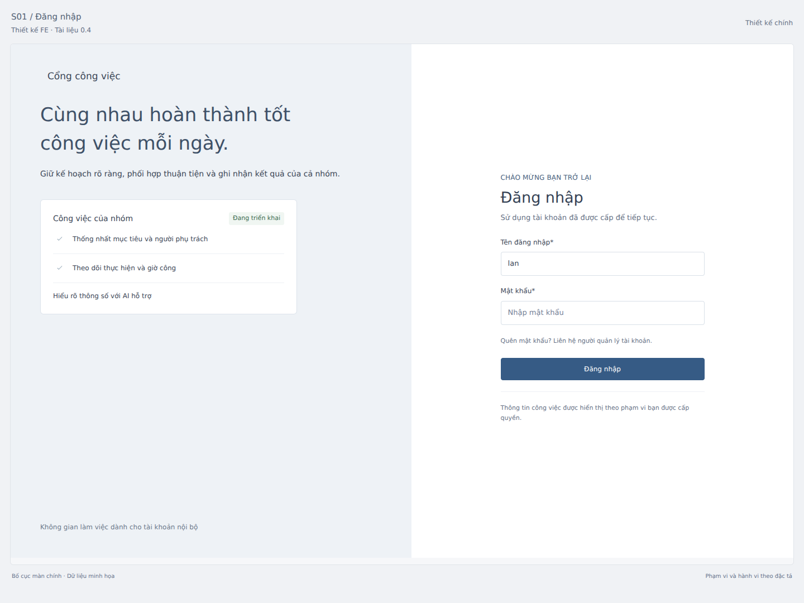

Persona trong ảnh chính: **Trần Lan · nhân viên/người nhận**. Áp dụng quyền từ phiên thực khi triển khai.

Trạng thái và cách xử lý: xem UI_STATES.txt theo mã Sxx; trạng thái nghiệp vụ/AI ở BUSINESS_STATES.txt và ANALYSIS_FLOW.txt.

- Feature: `auth`; dạng khung: `login`; route: `/login`.
- Phạm vi xem/thao tác: Mọi người chưa đăng nhập; chỉ có tài khoản nội bộ đã được cấp.
- Use Case: UC-A01.

| Nhãn ô | Tên form | Control | Ghi chú |
|---|---|---|---|
| Tên đăng nhập* | `username` | text | Có dấu * trong khung; kiểm tra điều kiện cụ thể trước submit |
| Mật khẩu* | `password` | password | Có dấu * trong khung; kiểm tra điều kiện cụ thể trước submit |

Action và đích: Đăng nhập → S02.

Điều kiện/diễn giải: Tài khoản nội bộ được cấp bởi người quản lý. Quên mật khẩu: liên hệ người quản lý tài khoản.

API: `login`; `logout`; `refreshSession`.

## S02 — Không gian làm việc

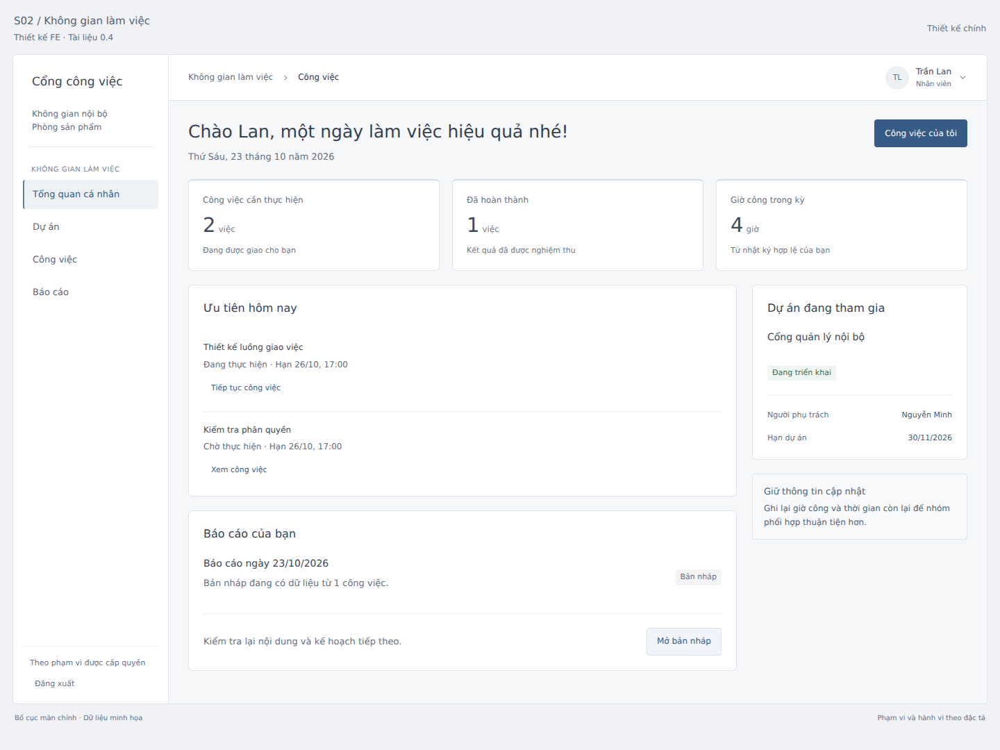

Persona trong ảnh chính: **Trần Lan · nhân viên/người nhận**. Áp dụng quyền từ phiên thực khi triển khai.

Trạng thái và cách xử lý: xem UI_STATES.txt theo mã Sxx; trạng thái nghiệp vụ/AI ở BUSINESS_STATES.txt và ANALYSIS_FLOW.txt.

- Feature: `workspace`; dạng khung: `home`; route: `/workspace`.
- Phạm vi xem/thao tác: Người đã đăng nhập; dữ liệu và menu theo quyền của phiên.
- Use Case: UC-A01, UC-A02, UC-T04, UC-P03.
- Bảng dữ liệu: Công việc của tôi, Trạng thái, Hạn hoàn thành.
- Vùng nội dung: Dự án đang tham gia; Cần thực hiện.

Action và đích: Xem công việc → S15; Lập báo cáo → S30.

Điều kiện/diễn giải: Chỉ hiển thị dự án và công việc thuộc phạm vi được phép xem.

API: `logout`; `refreshSession`; `getSession`; `listProjects`; `listTasks`.

## S03 — Tài khoản người dùng

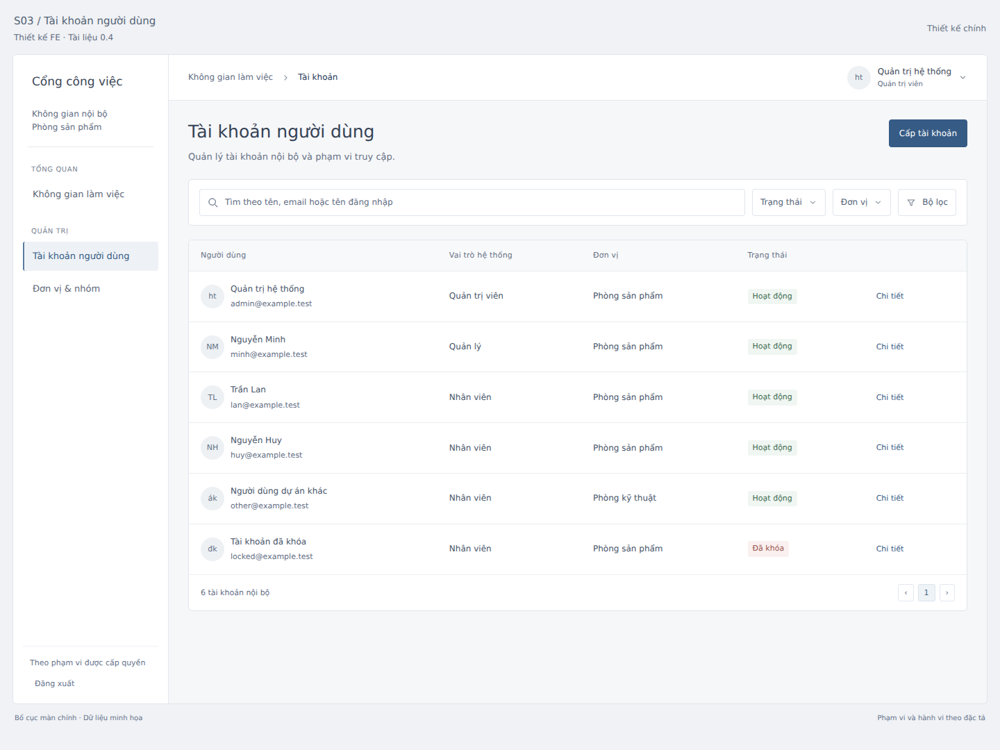

Persona trong ảnh chính: **Quản trị hệ thống · quản trị tài khoản/tổ chức**. Áp dụng quyền từ phiên thực khi triển khai.

Trạng thái và cách xử lý: xem UI_STATES.txt theo mã Sxx; trạng thái nghiệp vụ/AI ở BUSINESS_STATES.txt và ANALYSIS_FLOW.txt.

- Feature: `users`; dạng khung: `list`; route: `/admin/users`.
- Phạm vi xem/thao tác: Người có quyền USERS_MANAGE trong phạm vi quản lý.
- Use Case: UC-A03, UC-A04.
- Bảng dữ liệu: Người dùng, Vai trò hệ thống, Đơn vị, Tình trạng.

| Nhãn ô | Tên form | Control | Ghi chú |
|---|---|---|---|
| Tìm kiếm | `q` | search | Tùy điều kiện/loại thao tác; xem schema và whitelist |
| Trạng thái | `status` | select | Tùy điều kiện/loại thao tác; xem schema và whitelist |
| Đơn vị | `unitId` | select | Tùy điều kiện/loại thao tác; xem schema và whitelist |

Action và đích: Cấp tài khoản → S04; Xem và chỉnh sửa → S05.

API: `listUsers`.

## S04 — Cấp tài khoản nội bộ

Màn/biểu mẫu phụ: đặc tả đầy đủ bằng văn bản, áp dụng DESIGN_SYSTEM và mẫu màn chính cùng feature.

Persona trong ảnh chính: **Quản trị hệ thống · quản trị tài khoản/tổ chức**. Áp dụng quyền từ phiên thực khi triển khai.

Trạng thái và cách xử lý: xem UI_STATES.txt theo mã Sxx; trạng thái nghiệp vụ/AI ở BUSINESS_STATES.txt và ANALYSIS_FLOW.txt.

- Feature: `users`; dạng khung: `form`; route: `/admin/users/new`.
- Phạm vi xem/thao tác: Người có quyền USERS_MANAGE trong phạm vi quản lý.
- Use Case: UC-A03.

| Nhãn ô | Tên form | Control | Ghi chú |
|---|---|---|---|
| Tên đăng nhập* | `username` | text | Có dấu * trong khung; kiểm tra điều kiện cụ thể trước submit |
| Họ tên* | `displayName` | text | Có dấu * trong khung; kiểm tra điều kiện cụ thể trước submit |
| Email* | `email` | email | Có dấu * trong khung; kiểm tra điều kiện cụ thể trước submit |
| Đơn vị* | `unitId` | select | Có dấu * trong khung; kiểm tra điều kiện cụ thể trước submit |
| Vai trò hệ thống* | `systemRole` | select | Có dấu * trong khung; kiểm tra điều kiện cụ thể trước submit |
| Mật khẩu khởi tạo* | `initialPassword` | password | Có dấu * trong khung; kiểm tra điều kiện cụ thể trước submit |

Action và đích: Tạo tài khoản → S03; Hủy → S03.

Điều kiện/diễn giải: Chỉ được cấp vai trò trong thẩm quyền. Mật khẩu khởi tạo không xuất hiện trong danh sách hoặc lịch sử.

API: `createUser`.

## S05 — Chi tiết tài khoản

Màn/biểu mẫu phụ: đặc tả đầy đủ bằng văn bản, áp dụng DESIGN_SYSTEM và mẫu màn chính cùng feature.

Persona trong ảnh chính: **Quản trị hệ thống · quản trị tài khoản/tổ chức**. Áp dụng quyền từ phiên thực khi triển khai.

Trạng thái và cách xử lý: xem UI_STATES.txt theo mã Sxx; trạng thái nghiệp vụ/AI ở BUSINESS_STATES.txt và ANALYSIS_FLOW.txt.

- Feature: `users`; dạng khung: `form`; route: `/admin/users/[userId]`.
- Phạm vi xem/thao tác: Người có quyền USERS_MANAGE trong phạm vi quản lý.
- Use Case: UC-A04.

| Nhãn ô | Tên form | Control | Ghi chú |
|---|---|---|---|
| Họ tên* | `displayName` | text | Có dấu * trong khung; kiểm tra điều kiện cụ thể trước submit |
| Email* | `email` | email | Có dấu * trong khung; kiểm tra điều kiện cụ thể trước submit |
| Đơn vị* | `unitId` | select | Có dấu * trong khung; kiểm tra điều kiện cụ thể trước submit |
| Vai trò hệ thống* | `systemRole` | select | Có dấu * trong khung; kiểm tra điều kiện cụ thể trước submit |
| Lý do thay đổi quyền hoặc khóa | `reason` | textarea | Tùy điều kiện/loại thao tác; xem schema và whitelist |
| Chế độ khóa | `lockMode` | select | Tùy điều kiện/loại thao tác; xem schema và whitelist |
| Mật khẩu tạm khi cấp lại | `temporaryPassword` | password | Tùy điều kiện/loại thao tác; xem schema và whitelist |

Action và đích: Lưu thông tin → S03; Khóa hoặc mở khóa → S05; Cấp lại mật khẩu → S05.

Điều kiện/diễn giải: Khóa thông thường cần bàn giao việc mở. Khóa khẩn cấp ngăn truy cập ngay và giữ lịch sử để quản lý xử lý việc tồn đọng.

Quy tắc triển khai: Thông tin tài khoản, đổi quyền, khóa/mở khóa và cấp lại mật khẩu là các request riêng. Chỉ gửi trường của thao tác đang chọn; không gửi mật khẩu tạm vào updateUser.

API: `getUser`; `updateUser`; `lockUser`; `unlockUser`; `resetUserPassword`.

## S06 — Cơ cấu đơn vị

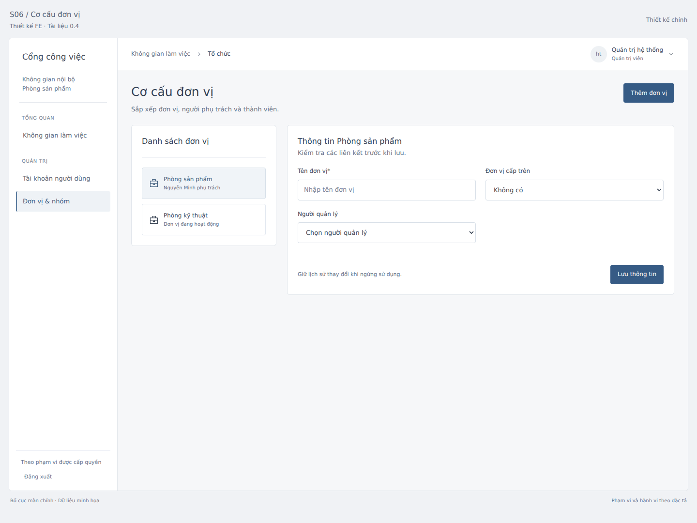

Persona trong ảnh chính: **Quản trị hệ thống · quản trị tài khoản/tổ chức**. Áp dụng quyền từ phiên thực khi triển khai.

Trạng thái và cách xử lý: xem UI_STATES.txt theo mã Sxx; trạng thái nghiệp vụ/AI ở BUSINESS_STATES.txt và ANALYSIS_FLOW.txt.

- Feature: `organization`; dạng khung: `organization`; route: `/admin/organization`.
- Phạm vi xem/thao tác: Người có quyền ORGANIZATION_MANAGE trong phạm vi đơn vị.
- Use Case: UC-A05.
- Bảng dữ liệu: Đơn vị, Cấp trên, Người quản lý, Tình trạng.

| Nhãn ô | Tên form | Control | Ghi chú |
|---|---|---|---|
| Tên đơn vị* | `name` | text | Có dấu * trong khung; kiểm tra điều kiện cụ thể trước submit |
| Đơn vị cấp trên | `parentId` | select | Tùy điều kiện/loại thao tác; xem schema và whitelist |
| Người quản lý | `managerId` | select | Tùy điều kiện/loại thao tác; xem schema và whitelist |

Action và đích: Lưu đơn vị → S06; Quản lý nhóm → S07; Ngừng sử dụng đơn vị → S06.

Điều kiện/diễn giải: Ngừng sử dụng đơn vị vẫn giữ lịch sử liên quan.

API: `listUnits`; `getUnit`; `createUnit`; `updateUnit`; `deactivateUnit`.

## S07 — Nhóm nhân sự

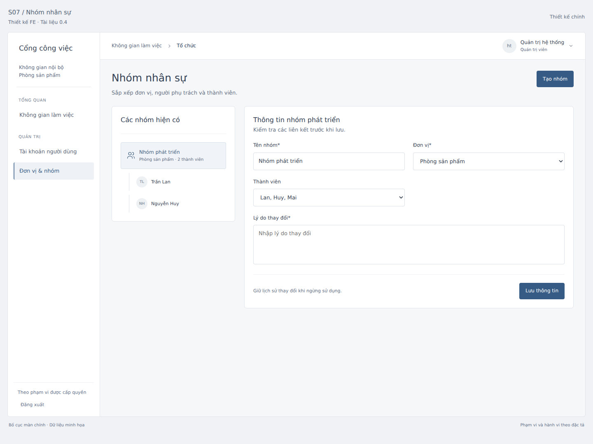

Persona trong ảnh chính: **Quản trị hệ thống · quản trị tài khoản/tổ chức**. Áp dụng quyền từ phiên thực khi triển khai.

Trạng thái và cách xử lý: xem UI_STATES.txt theo mã Sxx; trạng thái nghiệp vụ/AI ở BUSINESS_STATES.txt và ANALYSIS_FLOW.txt.

- Feature: `organization`; dạng khung: `organization`; route: `/admin/teams`.
- Phạm vi xem/thao tác: Người có quyền ORGANIZATION_MANAGE trong phạm vi đơn vị.
- Use Case: UC-A05.
- Bảng dữ liệu: Thành viên, Đơn vị, Tình trạng.

| Nhãn ô | Tên form | Control | Ghi chú |
|---|---|---|---|
| Tên nhóm* | `name` | text | Có dấu * trong khung; kiểm tra điều kiện cụ thể trước submit |
| Đơn vị* | `unitId` | select | Có dấu * trong khung; kiểm tra điều kiện cụ thể trước submit |
| Thành viên | `memberIds` | select | Tùy điều kiện/loại thao tác; xem schema và whitelist |
| Lý do thay đổi* | `reason` | textarea | Có dấu * trong khung; kiểm tra điều kiện cụ thể trước submit |

Action và đích: Lưu nhóm → S07; Ngừng sử dụng nhóm → S07.

Điều kiện/diễn giải: Thuộc cùng nhóm không tự cấp quyền truy cập dự án.

API: `listTeams`; `getTeam`; `createTeam`; `updateTeam`; `replaceTeamMembers`; `deactivateTeam`.

## S08 — Danh sách dự án

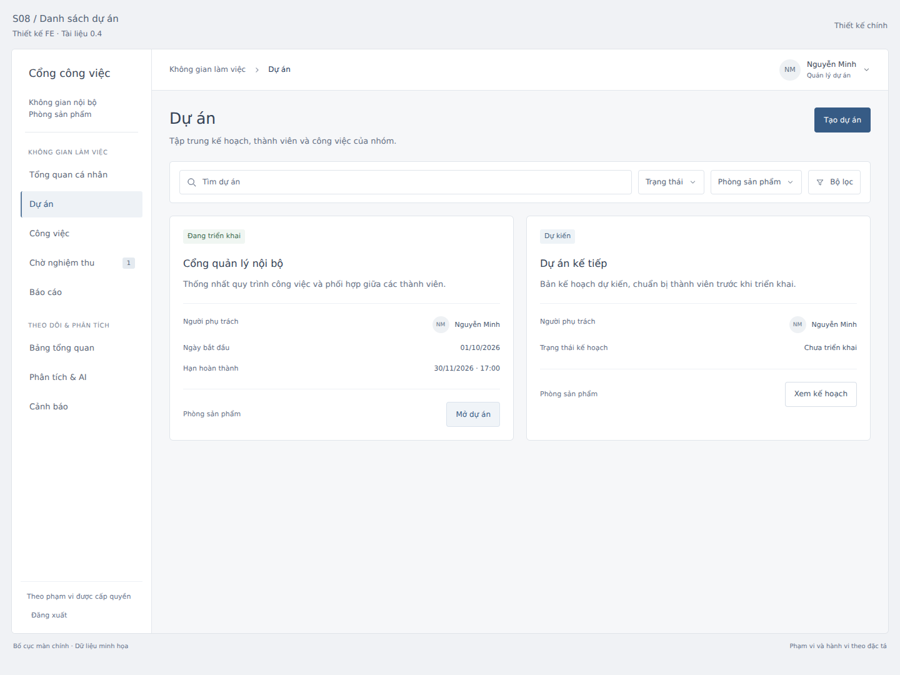

Persona trong ảnh chính: **Nguyễn Minh · quản lý có quyền dự án**. Áp dụng quyền từ phiên thực khi triển khai.

Trạng thái và cách xử lý: xem UI_STATES.txt theo mã Sxx; trạng thái nghiệp vụ/AI ở BUSINESS_STATES.txt và ANALYSIS_FLOW.txt.

- Feature: `projects`; dạng khung: `list`; route: `/projects`.
- Phạm vi xem/thao tác: Người được cấp quyền xem dự án; tạo mới cần PROJECT_CREATE.
- Use Case: UC-P03.
- Bảng dữ liệu: Dự án, Người phụ trách, Trạng thái, Hạn.

| Nhãn ô | Tên form | Control | Ghi chú |
|---|---|---|---|
| Tìm dự án | `q` | search | Tùy điều kiện/loại thao tác; xem schema và whitelist |
| Trạng thái | `status` | select | Tùy điều kiện/loại thao tác; xem schema và whitelist |
| Đơn vị | `unitId` | select | Tùy điều kiện/loại thao tác; xem schema và whitelist |

Action và đích: Tạo dự án → S09; Mở dự án → S10.

API: `listProjects`.

Ảnh FULL có thêm project p-planned theo fixture: mã PLAN, tên Dự án kế tiếp, owner u-pm, unit-product, PLANNED; ngày bắt đầu 01/11/2026, hạn 31/12/2026 17:00 Việt Nam, completedAt/cancelledAt=null. Card không tự hiển thị phần trăm tiến độ nếu API chưa trả dữ liệu đó.

## S09 — Tạo dự án

Màn/biểu mẫu phụ: đặc tả đầy đủ bằng văn bản, áp dụng DESIGN_SYSTEM và mẫu màn chính cùng feature.

Persona trong ảnh chính: **Nguyễn Minh · quản lý có quyền dự án**. Áp dụng quyền từ phiên thực khi triển khai.

Trạng thái và cách xử lý: xem UI_STATES.txt theo mã Sxx; trạng thái nghiệp vụ/AI ở BUSINESS_STATES.txt và ANALYSIS_FLOW.txt.

- Feature: `projects`; dạng khung: `form`; route: `/projects/new`.
- Phạm vi xem/thao tác: Người có quyền PROJECT_CREATE trong đơn vị.
- Use Case: UC-P01.

| Nhãn ô | Tên form | Control | Ghi chú |
|---|---|---|---|
| Tên dự án* | `name` | text | Có dấu * trong khung; kiểm tra điều kiện cụ thể trước submit |
| Mã dự án* | `code` | text | Có dấu * trong khung; kiểm tra điều kiện cụ thể trước submit |
| Mục tiêu* | `objective` | textarea | Có dấu * trong khung; kiểm tra điều kiện cụ thể trước submit |
| Đơn vị* | `unitId` | select | Có dấu * trong khung; kiểm tra điều kiện cụ thể trước submit |
| Người phụ trách* | `ownerId` | select | Có dấu * trong khung; kiểm tra điều kiện cụ thể trước submit |
| Ngày bắt đầu* | `startDate` | date | Có dấu * trong khung; kiểm tra điều kiện cụ thể trước submit |
| Hạn hoàn thành* | `dueAt` | datetime-local | Có dấu * trong khung; kiểm tra điều kiện cụ thể trước submit |

Action và đích: Tạo dự án → S10.

Điều kiện/diễn giải: Dự án mới ở trạng thái Dự kiến. Bổ sung thành viên và kế hoạch trước khi triển khai.

API: `createProject`.

## S10 — Cổng quản lý nội bộ

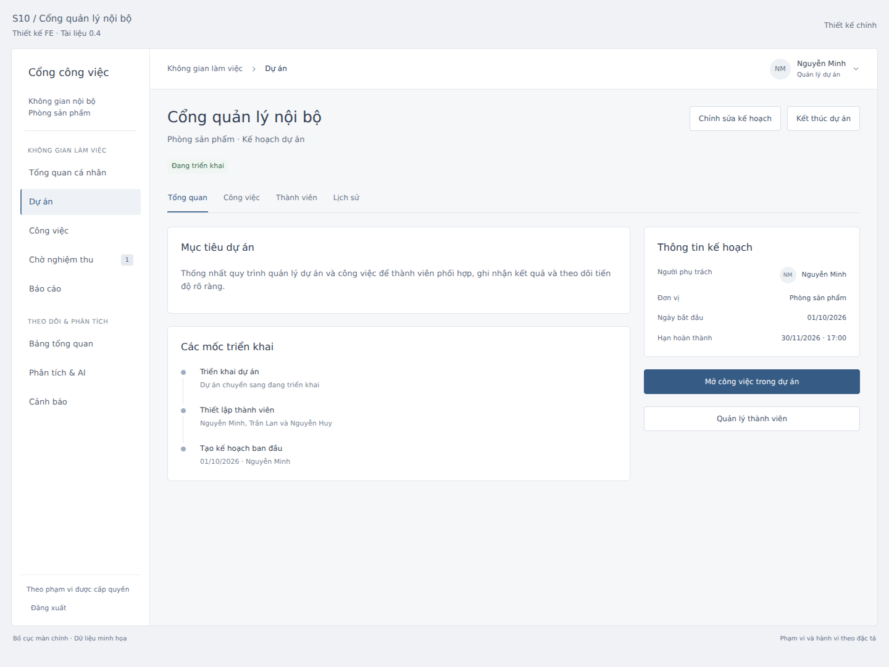

Persona trong ảnh chính: **Nguyễn Minh · quản lý có quyền dự án**. Áp dụng quyền từ phiên thực khi triển khai.

Trạng thái và cách xử lý: xem UI_STATES.txt theo mã Sxx; trạng thái nghiệp vụ/AI ở BUSINESS_STATES.txt và ANALYSIS_FLOW.txt.

- Feature: `projects`; dạng khung: `detail`; route: `/projects/[projectId]`.
- Phạm vi xem/thao tác: Người được cấp quyền xem dự án; từng action cần quyền tương ứng.
- Use Case: UC-P02, UC-P03.
- Tab: Tổng quan, Công việc, Thành viên, Phân quyền, Lịch sử.
- Vùng nội dung: Mục tiêu; Tiến độ theo công việc.

Action và đích: Chỉnh sửa kế hoạch → S11; Công việc → S15; Thành viên → S12; Kết thúc dự án → S14; Triển khai dự án Dự kiến → S10.

Điều kiện/diễn giải: Đang thực hiện · Người phụ trách: Nguyễn Minh · Hạn: 30/11/2026, 17:00

Quy tắc triển khai: Triển khai chỉ hiện khi PLANNED; kết thúc/hủy chỉ hiện khi trạng thái cho phép. Tab Lịch sử dùng listProjectHistory, không dùng lịch sử của một công việc.

API: `getProject`; `activateProject`; `listProjectHistory`.

## S11 — Điều chỉnh dự án

Màn/biểu mẫu phụ: đặc tả đầy đủ bằng văn bản, áp dụng DESIGN_SYSTEM và mẫu màn chính cùng feature.

Persona trong ảnh chính: **Nguyễn Minh · quản lý có quyền dự án**. Áp dụng quyền từ phiên thực khi triển khai.

Trạng thái và cách xử lý: xem UI_STATES.txt theo mã Sxx; trạng thái nghiệp vụ/AI ở BUSINESS_STATES.txt và ANALYSIS_FLOW.txt.

- Feature: `projects`; dạng khung: `form`; route: `/projects/[projectId]/edit`.
- Phạm vi xem/thao tác: Người có quyền PROJECT_MANAGE trên dự án.
- Use Case: UC-P02.

| Nhãn ô | Tên form | Control | Ghi chú |
|---|---|---|---|
| Tên dự án* | `name` | text | Có dấu * trong khung; kiểm tra điều kiện cụ thể trước submit |
| Mục tiêu* | `objective` | textarea | Có dấu * trong khung; kiểm tra điều kiện cụ thể trước submit |
| Người phụ trách* | `ownerId` | select | Có dấu * trong khung; kiểm tra điều kiện cụ thể trước submit |
| Ngày bắt đầu* | `startDate` | date | Có dấu * trong khung; kiểm tra điều kiện cụ thể trước submit |
| Hạn hoàn thành* | `dueAt` | datetime-local | Có dấu * trong khung; kiểm tra điều kiện cụ thể trước submit |
| Lý do điều chỉnh* | `changeReason` | textarea | Có dấu * trong khung; kiểm tra điều kiện cụ thể trước submit |

Action và đích: Lưu kế hoạch → S10.

Điều kiện/diễn giải: Không rút ngắn hạn dự án xuống trước hạn của các công việc hiện có.

API: `updateProject`.

## S12 — Thành viên dự án

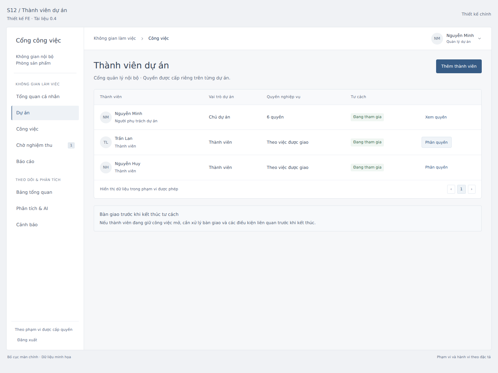

Persona trong ảnh chính: **Nguyễn Minh · quản lý có quyền dự án**. Áp dụng quyền từ phiên thực khi triển khai.

Trạng thái và cách xử lý: xem UI_STATES.txt theo mã Sxx; trạng thái nghiệp vụ/AI ở BUSINESS_STATES.txt và ANALYSIS_FLOW.txt.

- Feature: `project-members`; dạng khung: `list`; route: `/projects/[projectId]/members`.
- Phạm vi xem/thao tác: Người có quyền MEMBERS_MANAGE trên dự án; xem danh sách theo phạm vi được cấp.
- Use Case: UC-P04.
- Bảng dữ liệu: Thành viên, Vai trò dự án, Việc đang giữ, Tình trạng.

| Nhãn ô | Tên form | Control | Ghi chú |
|---|---|---|---|
| Thêm nhân viên | `userId` | select | Tùy điều kiện/loại thao tác; xem schema và whitelist |
| Vai trò dự án | `projectRole` | select | Tùy điều kiện/loại thao tác; xem schema và whitelist |
| Lý do nếu kết thúc thành viên | `reason` | textarea | Tùy điều kiện/loại thao tác; xem schema và whitelist |

Action và đích: Thêm thành viên → S12; Bàn giao công việc → S20; Đổi vai trò → S13; Kết thúc thành viên → S12.

Điều kiện/diễn giải: Bàn giao công việc trước khi kết thúc thành viên. Luôn duy trì ít nhất một người phụ trách hoạt động.

Quy tắc triển khai: Thành viên làm việc được giao; Leader/PM mang vai trò MANAGER trong dự án được quản lý dự án đó. Đổi vai trò qua dialog S13, không cấp quyền riêng. Kết thúc thành viên yêu cầu chọn đúng membershipId, reason và bàn giao việc mở.

API: `listProjectMembers`; `addProjectMember`; `endProjectMembership`.

## S13 — Đổi vai trò thành viên

- Feature: `project-members`; dialog trên `/projects/[projectId]/members#member-role`.
- Người thực hiện: tài khoản MANAGER có vai trò OWNER/MANAGER đang hoạt động trong dự án.
- Use Case: UC-P05.

| Nhãn ô | Tên form | Control | Ghi chú |
|---|---|---|---|
| Vai trò dự án* | `projectRole` | select | MEMBER hoặc MANAGER; MANAGER chỉ dành cho tài khoản Leader/PM |
| Lý do thay đổi* | `reason` | textarea | Bắt buộc, ghi audit |

Mở từ hành động Đổi vai trò trên dòng thành viên; lưu thành công đóng dialog và làm mới danh sách/phiên. Không sửa OWNER hoặc tư cách đã kết thúc. Đổi người phụ trách ở S11. Giữ If-Match, idempotency và đối chiếu khi 412; backend kiểm tra role/phạm vi. Không có checkbox hoặc mảng quyền cấp lẻ; người nghiệm thu vẫn phải khác người nộp.

API: `updateProjectMemberRole`.

## S14 — Kết thúc dự án

Màn/biểu mẫu phụ: đặc tả đầy đủ bằng văn bản, áp dụng DESIGN_SYSTEM và mẫu màn chính cùng feature.

Persona trong ảnh chính: **Nguyễn Minh · quản lý có quyền dự án**. Áp dụng quyền từ phiên thực khi triển khai.

Trạng thái và cách xử lý: xem UI_STATES.txt theo mã Sxx; trạng thái nghiệp vụ/AI ở BUSINESS_STATES.txt và ANALYSIS_FLOW.txt.

- Feature: `projects`; dạng khung: `dialog`; route: `/projects/[projectId]#close`.
- Phạm vi xem/thao tác: Người có quyền PROJECT_MANAGE trên dự án.
- Use Case: UC-P02.
- Vùng nội dung: Kiểm tra trước khi kết thúc.

| Nhãn ô | Tên form | Control | Ghi chú |
|---|---|---|---|
| Thao tác* | `action` | select | Có dấu * trong khung; kiểm tra điều kiện cụ thể trước submit |
| Lý do nếu hủy | `reason` | textarea | Tùy điều kiện/loại thao tác; xem schema và whitelist |

Action và đích: Kiểm tra điều kiện và xác nhận → S10; Quay lại → S10.

Điều kiện/diễn giải: Chỉ kết thúc khi không còn công việc mở hoặc kết quả chờ nghiệm thu và đã giải quyết báo cáo cần gửi.

API: `getProjectClosureChecks`; `completeProject`; `cancelProject`.

## S15 — Công việc

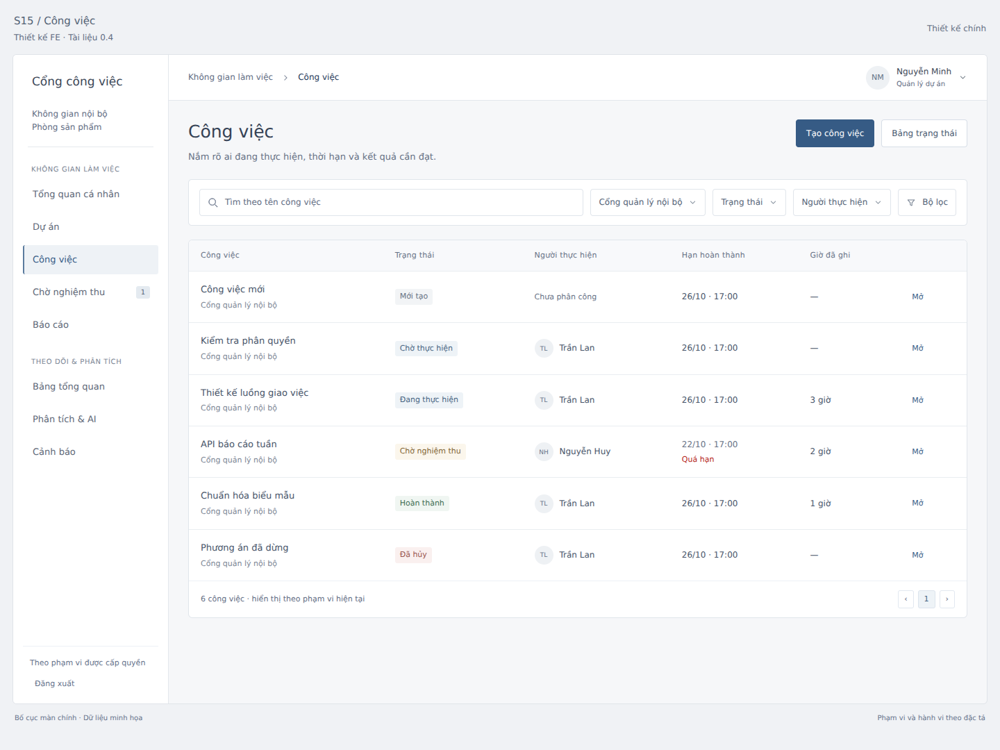

Persona trong ảnh chính: **Nguyễn Minh · quản lý có quyền dự án**. Áp dụng quyền từ phiên thực khi triển khai.

Trạng thái và cách xử lý: xem UI_STATES.txt theo mã Sxx; trạng thái nghiệp vụ/AI ở BUSINESS_STATES.txt và ANALYSIS_FLOW.txt.

- Feature: `tasks`; dạng khung: `list`; route: `/tasks`.
- Phạm vi xem/thao tác: Nhân viên xem việc hiện tại/từng tham gia khi còn quyền; người quản lý xem phạm vi được cấp.
- Use Case: UC-T04.
- Bảng dữ liệu: Công việc, Người nhận, Trạng thái, Hạn hoàn thành.

| Nhãn ô | Tên form | Control | Ghi chú |
|---|---|---|---|
| Tìm công việc | `q` | search | Tùy điều kiện/loại thao tác; xem schema và whitelist |
| Dự án | `projectId` | select | Tùy điều kiện/loại thao tác; xem schema và whitelist |
| Trạng thái | `status` | select | Tùy điều kiện/loại thao tác; xem schema và whitelist |
| Người thực hiện | `assigneeId` | select | Tùy điều kiện/loại thao tác; xem schema và whitelist |
| Chỉ việc quá hạn | `overdue` | checkbox | Tùy điều kiện/loại thao tác; xem schema và whitelist |

Action và đích: Tạo công việc → S17; Bảng trạng thái → S16; Mở công việc → S18.

API: `listTasks`.

## S16 — Bảng trạng thái công việc

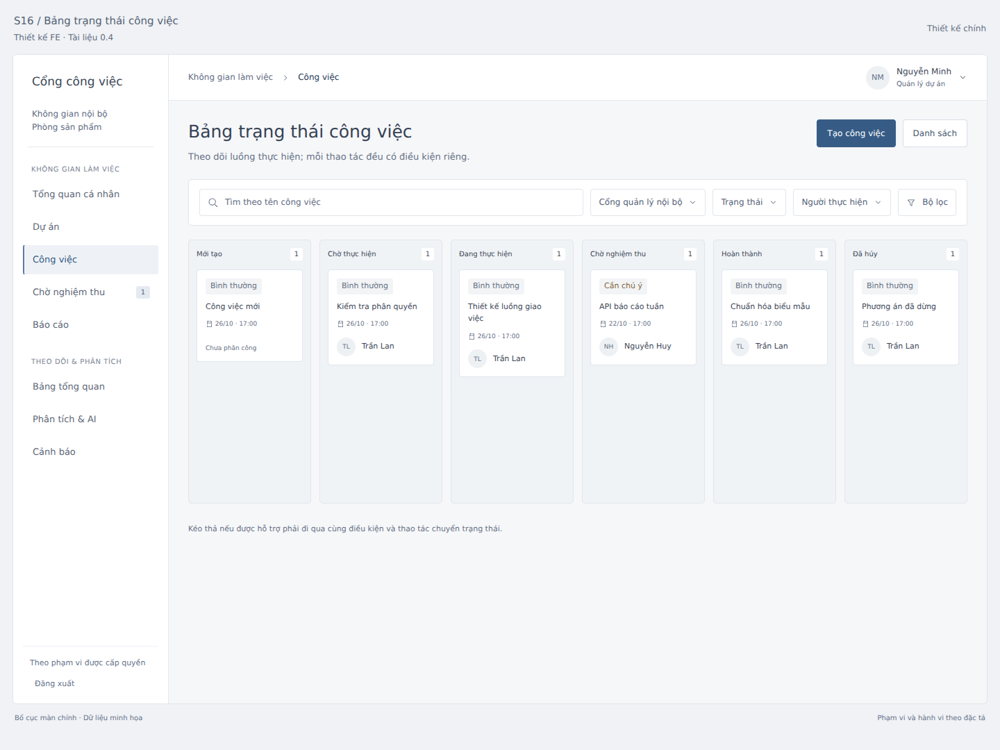

Persona trong ảnh chính: **Nguyễn Minh · quản lý có quyền dự án**. Áp dụng quyền từ phiên thực khi triển khai.

Trạng thái và cách xử lý: xem UI_STATES.txt theo mã Sxx; trạng thái nghiệp vụ/AI ở BUSINESS_STATES.txt và ANALYSIS_FLOW.txt.

- Feature: `tasks`; dạng khung: `board`; route: `/tasks?view=board`.
- Phạm vi xem/thao tác: Cùng quyền đọc S15; không có quyền mới chỉ vì chọn board.
- Use Case: UC-T04.

Action và đích: Dạng danh sách → S15; Tạo công việc → S17; Mở công việc → S18.

Điều kiện/diễn giải: Quá hạn là một dấu hiệu riêng. Các chuyển trạng thái thực hiện bằng thao tác có kiểm tra điều kiện.

API: `listTasks`.

## S17 — Tạo công việc

Màn/biểu mẫu phụ: đặc tả đầy đủ bằng văn bản, áp dụng DESIGN_SYSTEM và mẫu màn chính cùng feature.

Persona trong ảnh chính: **Nguyễn Minh · quản lý có quyền dự án**. Áp dụng quyền từ phiên thực khi triển khai.

Trạng thái và cách xử lý: xem UI_STATES.txt theo mã Sxx; trạng thái nghiệp vụ/AI ở BUSINESS_STATES.txt và ANALYSIS_FLOW.txt.

- Feature: `tasks`; dạng khung: `form`; route: `/projects/[projectId]/tasks/new`.
- Phạm vi xem/thao tác: Người có quyền TASKS_MANAGE trên dự án.
- Use Case: UC-T01.

| Nhãn ô | Tên form | Control | Ghi chú |
|---|---|---|---|
| Tên công việc* | `title` | text | Có dấu * trong khung; kiểm tra điều kiện cụ thể trước submit |
| Mô tả | `description` | textarea | Tùy điều kiện/loại thao tác; xem schema và whitelist |
| Tiêu chí nghiệm thu* | `acceptanceCriteria` | textarea | Có dấu * trong khung; kiểm tra điều kiện cụ thể trước submit |
| Ưu tiên* | `priority` | select | Có dấu * trong khung; kiểm tra điều kiện cụ thể trước submit |
| Hạn hoàn thành* | `dueAt` | datetime-local | Có dấu * trong khung; kiểm tra điều kiện cụ thể trước submit |
| Thời gian dự kiến (phút)* | `estimatedMinutes` | number | Có dấu * trong khung; kiểm tra điều kiện cụ thể trước submit |

Action và đích: Tạo công việc → S18.

Điều kiện/diễn giải: Tên từ 1–255 ký tự sau khi bỏ khoảng trắng đầu cuối. Hạn mới phải ở tương lai và không vượt hạn dự án.

API: `createTask`.

## S18 — Chi tiết công việc

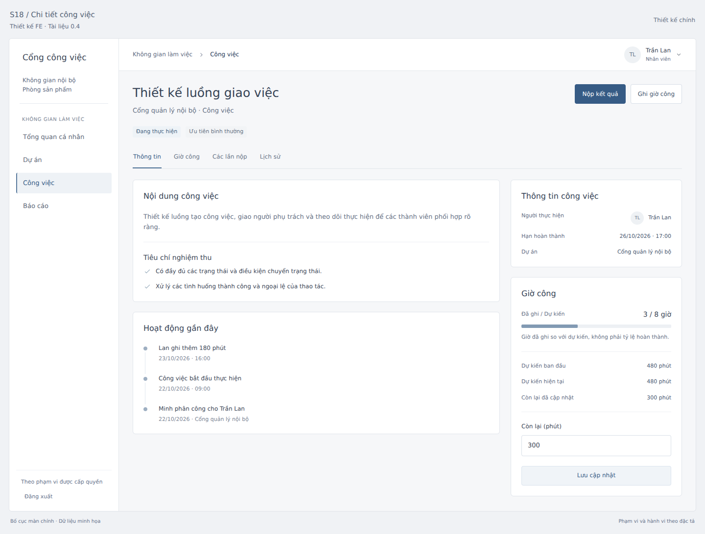

Persona trong ảnh chính: **Trần Lan · nhân viên/người nhận**. Áp dụng quyền từ phiên thực khi triển khai.

Trạng thái và cách xử lý: xem UI_STATES.txt theo mã Sxx; trạng thái nghiệp vụ/AI ở BUSINESS_STATES.txt và ANALYSIS_FLOW.txt.

- Feature: `tasks`; dạng khung: `detail`; route: `/tasks/[taskId]`.
- Phạm vi xem/thao tác: Người được xem công việc; action thực hiện/điều chỉnh xuất hiện theo quyền và trạng thái.
- Use Case: UC-T04, UC-D03.
- Tab: Thông tin, Giờ công, Các lần nộp, Lịch sử.
- Vùng nội dung: Nội dung công việc; Tiêu chí nghiệm thu; Thời gian.

| Nhãn ô | Tên form | Control | Ghi chú |
|---|---|---|---|
| Phút còn lại | `remainingMinutes` | number | Tùy điều kiện/loại thao tác; xem schema và whitelist |

Action và đích: Nộp kết quả → S24; Ghi giờ công → S23; Giờ công → S22; Các lần nộp → S25; Lịch sử → S28; Lưu phút còn lại → S18.

Điều kiện/diễn giải: Đang thực hiện · Trần Lan · Ưu tiên bình thường · Hạn 26/10, 17:00

Quy tắc triển khai: Bắt đầu chỉ TODO; tạm dừng/ghi giờ/nộp chỉ IN_PROGRESS và đúng người nhận. Sửa/giao cần TASKS_MANAGE. Cập nhật phút còn lại là command riêng, không thay dự kiến hoặc tổng giờ.

API: `getTask`; `updateRemainingEstimate`.

Ảnh chính dùng Lan đang làm t-3, chỉ có nộp/ghi giờ/cập nhật còn lại và xem lịch sử. Quản lý có thể sửa/phân công theo quyền và trạng thái tại S19/S20; không hiện các nút đó cho Lan khi thiếu quyền.

## S19 — Điều chỉnh công việc

Màn/biểu mẫu phụ: đặc tả đầy đủ bằng văn bản, áp dụng DESIGN_SYSTEM và mẫu màn chính cùng feature.

Persona trong ảnh chính: **Nguyễn Minh · quản lý có quyền dự án**. Áp dụng quyền từ phiên thực khi triển khai.

Trạng thái và cách xử lý: xem UI_STATES.txt theo mã Sxx; trạng thái nghiệp vụ/AI ở BUSINESS_STATES.txt và ANALYSIS_FLOW.txt.

- Feature: `tasks`; dạng khung: `form`; route: `/tasks/[taskId]/edit`.
- Phạm vi xem/thao tác: Người có quyền TASKS_MANAGE trên dự án.
- Use Case: UC-T03.

| Nhãn ô | Tên form | Control | Ghi chú |
|---|---|---|---|
| Tên công việc* | `title` | text | Có dấu * trong khung; kiểm tra điều kiện cụ thể trước submit |
| Mô tả | `description` | textarea | Tùy điều kiện/loại thao tác; xem schema và whitelist |
| Tiêu chí nghiệm thu* | `acceptanceCriteria` | textarea | Có dấu * trong khung; kiểm tra điều kiện cụ thể trước submit |
| Ưu tiên* | `priority` | select | Có dấu * trong khung; kiểm tra điều kiện cụ thể trước submit |
| Hạn hoàn thành* | `dueAt` | datetime-local | Có dấu * trong khung; kiểm tra điều kiện cụ thể trước submit |
| Thời gian dự kiến (phút)* | `estimatedMinutes` | number | Có dấu * trong khung; kiểm tra điều kiện cụ thể trước submit |
| Lý do thay đổi kế hoạch* | `changeReason` | textarea | Có dấu * trong khung; kiểm tra điều kiện cụ thể trước submit |

Action và đích: Lưu thay đổi → S18.

Điều kiện/diễn giải: Khi Chờ nghiệm thu, Hoàn thành hoặc Đã hủy, không được chỉnh sửa. Hạn gốc và các lần điều chỉnh được giữ.

Quy tắc triển khai: changeReason bắt buộc khi thay hạn hoặc dự kiến sau khi giao. Chỉ gửi dirty fields hợp lệ; giữ originalDueAt/originalEstimatedMinutes.

API: `updateTask`.

## S20 — Giao hoặc bàn giao công việc

Màn/biểu mẫu phụ: đặc tả đầy đủ bằng văn bản, áp dụng DESIGN_SYSTEM và mẫu màn chính cùng feature.

Persona trong ảnh chính: **Nguyễn Minh · quản lý có quyền dự án**. Áp dụng quyền từ phiên thực khi triển khai.

Trạng thái và cách xử lý: xem UI_STATES.txt theo mã Sxx; trạng thái nghiệp vụ/AI ở BUSINESS_STATES.txt và ANALYSIS_FLOW.txt.

- Feature: `tasks`; dạng khung: `dialog`; route: `/tasks/[taskId]#assignment`.
- Phạm vi xem/thao tác: Người có quyền TASKS_MANAGE trên dự án.
- Use Case: UC-T02.

| Nhãn ô | Tên form | Control | Ghi chú |
|---|---|---|---|
| Người nhận mới* | `assigneeId` | select | Có dấu * trong khung; kiểm tra điều kiện cụ thể trước submit |
| Lý do bàn giao | `reason` | textarea | Tùy điều kiện/loại thao tác; xem schema và whitelist |

Action và đích: Xác nhận phân công → S18; Quay lại → S18.

Điều kiện/diễn giải: Tối đa một người chịu trách nhiệm hiện tại. Giờ công cũ vẫn thuộc người đã ghi; không đổi người khi chờ nghiệm thu.

API: `assignTask`.

## S21 — Thực hiện hoặc dừng công việc

Màn/biểu mẫu phụ: đặc tả đầy đủ bằng văn bản, áp dụng DESIGN_SYSTEM và mẫu màn chính cùng feature.

Persona trong ảnh chính: **Trần Lan · nhân viên/người nhận**. Áp dụng quyền từ phiên thực khi triển khai.

Trạng thái và cách xử lý: xem UI_STATES.txt theo mã Sxx; trạng thái nghiệp vụ/AI ở BUSINESS_STATES.txt và ANALYSIS_FLOW.txt.

- Feature: `tasks`; dạng khung: `dialog`; route: `/tasks/[taskId]#execution`.
- Phạm vi xem/thao tác: Bắt đầu/tạm dừng: người nhận hiện tại; hủy: TASKS_MANAGE.
- Use Case: UC-T03, UC-T05.

| Nhãn ô | Tên form | Control | Ghi chú |
|---|---|---|---|
| Thao tác* | `action` | select | Có dấu * trong khung; kiểm tra điều kiện cụ thể trước submit |
| Lý do tạm dừng hoặc hủy | `reason` | textarea | Tùy điều kiện/loại thao tác; xem schema và whitelist |

Action và đích: Xác nhận → S18; Quay lại → S18.

Điều kiện/diễn giải: Bắt đầu: Chờ thực hiện → Đang thực hiện. Tạm dừng: Đang thực hiện → Chờ thực hiện. Hủy chỉ dành cho người quản lý có quyền.

Quy tắc triển khai: Chỉ render action hợp lệ theo người xem và trạng thái; action selector trong khung biểu diễn các biến thể, không phải cho phép mọi action ở mọi trạng thái.

API: `startTask`; `pauseTask`; `cancelTask`.

## S22 — Nhật ký giờ công

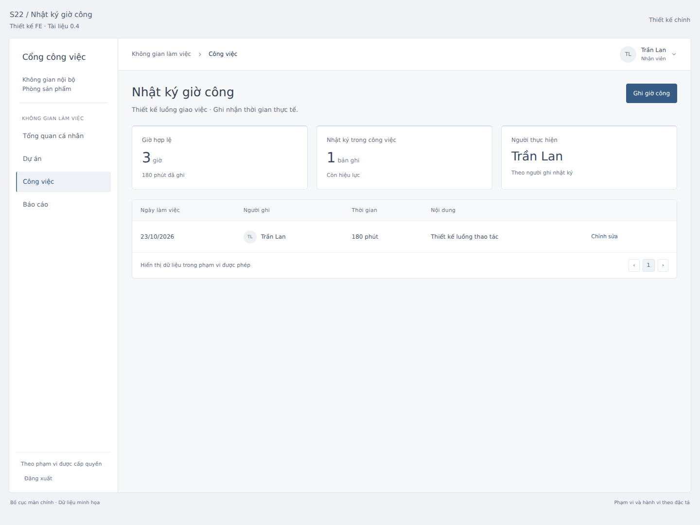

Persona trong ảnh chính: **Trần Lan · nhân viên/người nhận**. Áp dụng quyền từ phiên thực khi triển khai.

Trạng thái và cách xử lý: xem UI_STATES.txt theo mã Sxx; trạng thái nghiệp vụ/AI ở BUSINESS_STATES.txt và ANALYSIS_FLOW.txt.

- Feature: `time-logs`; dạng khung: `list`; route: `/tasks/[taskId]/time-logs`.
- Phạm vi xem/thao tác: Người được xem công việc; sửa/VOID chỉ chủ nhật ký đang là người nhận hiện tại.
- Use Case: UC-T06.
- Bảng dữ liệu: Ngày làm việc, Người ghi, Số phút, Nội dung.

Action và đích: Ghi thời gian → S23; Sửa nhật ký → S23; Lịch sử → S28.

Điều kiện/diễn giải: Tổng: 180 phút = 3 giờ. Nhật ký đã loại khỏi tổng vẫn có dấu vết trong lịch sử.

API: `listTimeLogs`.

## S23 — Ghi hoặc chỉnh giờ công

Màn/biểu mẫu phụ: đặc tả đầy đủ bằng văn bản, áp dụng DESIGN_SYSTEM và mẫu màn chính cùng feature.

Persona trong ảnh chính: **Trần Lan · nhân viên/người nhận**. Áp dụng quyền từ phiên thực khi triển khai.

Trạng thái và cách xử lý: xem UI_STATES.txt theo mã Sxx; trạng thái nghiệp vụ/AI ở BUSINESS_STATES.txt và ANALYSIS_FLOW.txt.

- Feature: `time-logs`; dạng khung: `dialog`; route: `/tasks/[taskId]#time-log`.
- Phạm vi xem/thao tác: Người nhận hiện tại, dự án ACTIVE; thao tác thực hiện theo trạng thái.
- Use Case: UC-T06.

| Nhãn ô | Tên form | Control | Ghi chú |
|---|---|---|---|
| Ngày làm việc* | `workDate` | date | Có dấu * trong khung; kiểm tra điều kiện cụ thể trước submit |
| Số phút* | `minutes` | number | Có dấu * trong khung; kiểm tra điều kiện cụ thể trước submit |
| Nội dung thực hiện* | `description` | textarea | Có dấu * trong khung; kiểm tra điều kiện cụ thể trước submit |
| Lý do nếu sửa hoặc loại bỏ | `reason` | textarea | Tùy điều kiện/loại thao tác; xem schema và whitelist |

Action và đích: Lưu nhật ký → S22; Loại nhật ký đã chọn khỏi tổng → S22.

Điều kiện/diễn giải: Chỉ người nhận hiện tại sửa nhật ký của mình khi công việc Đang thực hiện. Tổng trên mọi công việc không vượt 1.440 phút/ngày.

Quy tắc triển khai: Create dùng If-Match của Task; edit/VOID dùng If-Match của TimeLog. Reason chỉ bắt buộc khi sửa/VOID.

API: `createTimeLog`; `updateTimeLog`; `voidTimeLog`.

## S24 — Nộp kết quả công việc

Màn/biểu mẫu phụ: đặc tả đầy đủ bằng văn bản, áp dụng DESIGN_SYSTEM và mẫu màn chính cùng feature.

Persona trong ảnh chính: **Trần Lan · nhân viên/người nhận**. Áp dụng quyền từ phiên thực khi triển khai.

Trạng thái và cách xử lý: xem UI_STATES.txt theo mã Sxx; trạng thái nghiệp vụ/AI ở BUSINESS_STATES.txt và ANALYSIS_FLOW.txt.

- Feature: `submissions`; dạng khung: `form`; route: `/tasks/[taskId]#submit`.
- Phạm vi xem/thao tác: Người nhận hiện tại, dự án ACTIVE; thao tác thực hiện theo trạng thái.
- Use Case: UC-T07.
- Vùng nội dung: Tiêu chí nghiệm thu.

| Nhãn ô | Tên form | Control | Ghi chú |
|---|---|---|---|
| Tóm tắt kết quả* | `summary` | textarea | Có dấu * trong khung; kiểm tra điều kiện cụ thể trước submit |
| Liên kết minh chứng | `links` | url | Tùy điều kiện/loại thao tác; xem schema và whitelist |
| Tệp minh chứng | `attachmentIds` | file | Tùy điều kiện/loại thao tác; xem schema và whitelist |

Action và đích: Tải minh chứng → S41; Xác nhận nộp → S25.

Điều kiện/diễn giải: Cần có giờ công hợp lệ. Tệp phải tải lên hoàn tất trước khi nộp. Kết quả đã nộp không sửa trực tiếp; nộp lại tạo lần mới.

Quy tắc triển khai: Chỉ nộp khi có giờ công hợp lệ và tất cả attachmentIds đã READY. Link/tệp được để trống; summary không được trống.

API: `createSubmission`; `getAttachment`.

## S25 — Các lần nộp kết quả

Màn/biểu mẫu phụ: đặc tả đầy đủ bằng văn bản, áp dụng DESIGN_SYSTEM và mẫu màn chính cùng feature.

Persona trong ảnh chính: **Nguyễn Huy · nhân viên/người nộp**. Áp dụng quyền từ phiên thực khi triển khai.

Trạng thái và cách xử lý: xem UI_STATES.txt theo mã Sxx; trạng thái nghiệp vụ/AI ở BUSINESS_STATES.txt và ANALYSIS_FLOW.txt.

- Feature: `submissions`; dạng khung: `list`; route: `/tasks/[taskId]/submissions`.
- Phạm vi xem/thao tác: Người được xem công việc; hành vi nghiệm thu cần TASKS_REVIEW riêng.
- Use Case: UC-T07, UC-T08, UC-T09.
- Bảng dữ liệu: Lần nộp, Người nộp, Thời điểm, Kết quả xét.

Action và đích: Xem kết quả mới nhất → S27; Xem lịch sử → S28.

Điều kiện/diễn giải: Mỗi lần lưu riêng hạn và tổng giờ công tại lúc nộp. Chỉ có một lần đang chờ xét.

API: `listSubmissions`.

## S26 — Kết quả chờ nghiệm thu

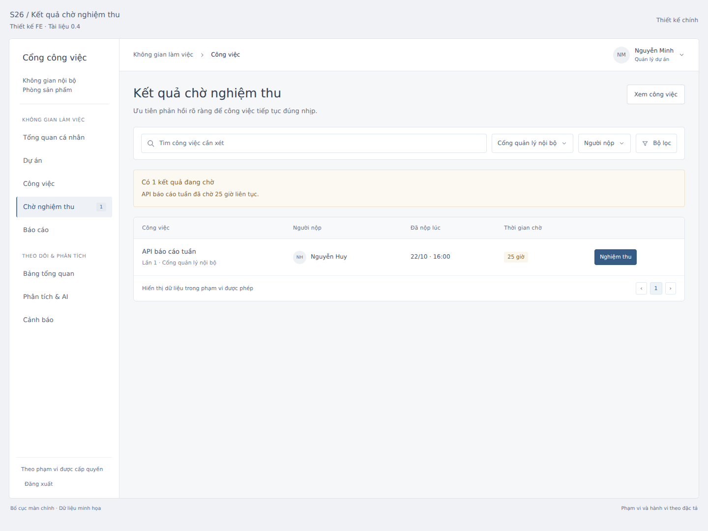

Persona trong ảnh chính: **Nguyễn Minh · quản lý có quyền dự án**. Áp dụng quyền từ phiên thực khi triển khai.

Trạng thái và cách xử lý: xem UI_STATES.txt theo mã Sxx; trạng thái nghiệp vụ/AI ở BUSINESS_STATES.txt và ANALYSIS_FLOW.txt.

- Feature: `submissions`; dạng khung: `list`; route: `/reviews`.
- Phạm vi xem/thao tác: Người có quyền TASKS_REVIEW; khác người nộp, chỉ xét lần mới nhất đang chờ.
- Use Case: UC-T08, UC-T09.
- Bảng dữ liệu: Công việc, Người nộp, Nộp lúc, Thời gian chờ.

| Nhãn ô | Tên form | Control | Ghi chú |
|---|---|---|---|
| Dự án | `projectId` | select | Tùy điều kiện/loại thao tác; xem schema và whitelist |

Action và đích: Mở kết quả → S27.

API: `listTasks`; `listReviewQueue`.

## S27 — Đối chiếu và nghiệm thu

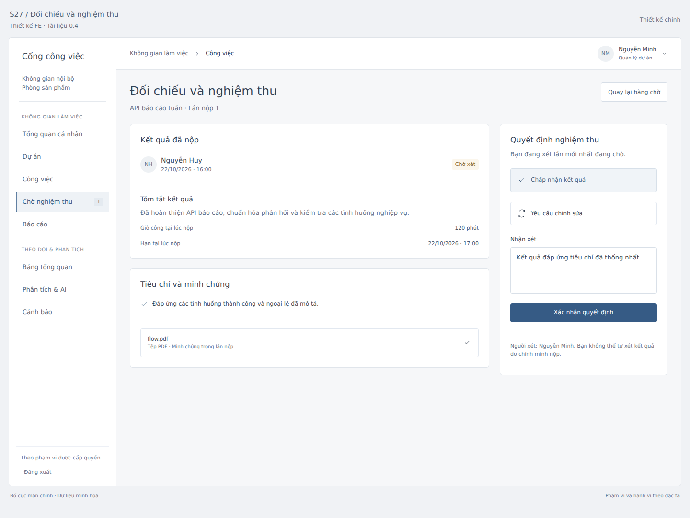

Persona trong ảnh chính: **Nguyễn Minh · quản lý có quyền dự án**. Áp dụng quyền từ phiên thực khi triển khai.

Trạng thái và cách xử lý: xem UI_STATES.txt theo mã Sxx; trạng thái nghiệp vụ/AI ở BUSINESS_STATES.txt và ANALYSIS_FLOW.txt.

- Feature: `submissions`; dạng khung: `review`; route: `/tasks/[taskId]/submissions/[submissionId]`.
- Phạm vi xem/thao tác: Người có quyền TASKS_REVIEW; khác người nộp, chỉ xét lần mới nhất đang chờ.
- Use Case: UC-T08, UC-T09.
- Vùng nội dung: Tiêu chí nghiệm thu; Kết quả đã nộp; Minh chứng.

| Nhãn ô | Tên form | Control | Ghi chú |
|---|---|---|---|
| Quyết định* | `decision` | select | Có dấu * trong khung; kiểm tra điều kiện cụ thể trước submit |
| Nhận xét / lý do yêu cầu sửa | `comment` | textarea | Tùy điều kiện/loại thao tác; xem schema và whitelist |
| Nội dung cần sửa | `requestedChanges` | textarea | Tùy điều kiện/loại thao tác; xem schema và whitelist |

Action và đích: Xác nhận quyết định → S18; Quay lại danh sách → S26.

Điều kiện/diễn giải: Chỉ xét lần mới nhất đang chờ. Người xét phải có quyền trên dự án và khác người nộp.

Quy tắc triển khai: Chấp nhận: comment tùy chọn. Yêu cầu sửa: reason và requestedChanges bắt buộc. Không gửi field decision chung; gọi đúng endpoint approve/request-revision.

API: `getSubmission`; `approveSubmission`; `requestSubmissionRevision`; `getAttachment`; `downloadAttachment`.

## S28 — Lịch sử công việc

Màn/biểu mẫu phụ: đặc tả đầy đủ bằng văn bản, áp dụng DESIGN_SYSTEM và mẫu màn chính cùng feature.

Persona trong ảnh chính: **Trần Lan · nhân viên/người nhận**. Áp dụng quyền từ phiên thực khi triển khai.

Trạng thái và cách xử lý: xem UI_STATES.txt theo mã Sxx; trạng thái nghiệp vụ/AI ở BUSINESS_STATES.txt và ANALYSIS_FLOW.txt.

- Feature: `tasks`; dạng khung: `timeline`; route: `/tasks/[taskId]/history`.
- Phạm vi xem/thao tác: Người được xem công việc; lịch sử chỉ đọc.
- Use Case: UC-T11.
- Bảng dữ liệu: Thời điểm, Người thao tác, Sự kiện, Thay đổi.

Điều kiện/diễn giải: Lưu nội dung trước/sau, người thực hiện, thời điểm và lý do. Không sửa trực tiếp lịch sử.

API: `listTaskHistory`.

## S29 — Báo cáo công việc

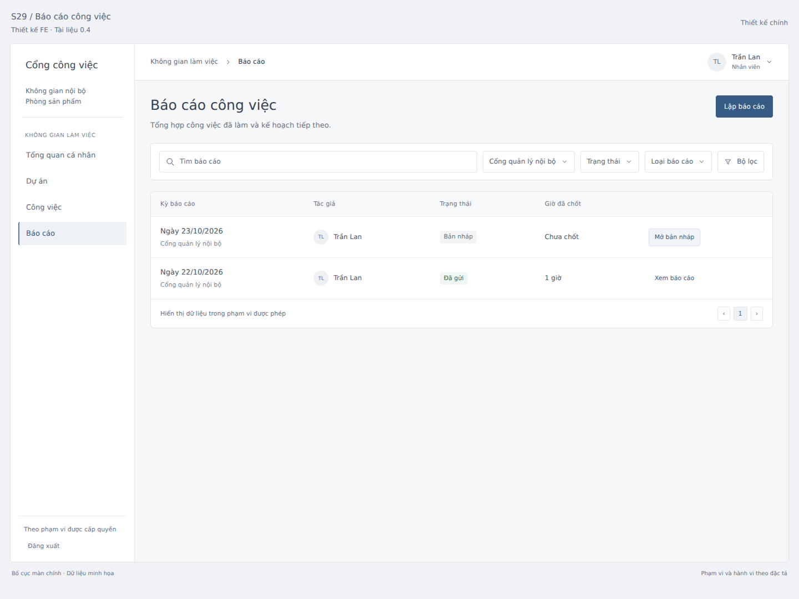

Persona trong ảnh chính: **Trần Lan · nhân viên/người nhận**. Áp dụng quyền từ phiên thực khi triển khai.

Trạng thái và cách xử lý: xem UI_STATES.txt theo mã Sxx; trạng thái nghiệp vụ/AI ở BUSINESS_STATES.txt và ANALYSIS_FLOW.txt.

- Feature: `reports`; dạng khung: `list`; route: `/reports`.
- Phạm vi xem/thao tác: Tác giả xem nháp của mình; quản lý có quyền xem bản đã gửi trong phạm vi.
- Use Case: UC-T10, UC-T11.
- Bảng dữ liệu: Báo cáo, Người lập, Tổng phút, Trạng thái.

| Nhãn ô | Tên form | Control | Ghi chú |
|---|---|---|---|
| Dự án | `projectId` | select | Tùy điều kiện/loại thao tác; xem schema và whitelist |
| Loại kỳ | `periodType` | select | Tùy điều kiện/loại thao tác; xem schema và whitelist |
| Người báo cáo | `authorId` | select | Tùy điều kiện/loại thao tác; xem schema và whitelist |
| Trạng thái | `status` | select | Tùy điều kiện/loại thao tác; xem schema và whitelist |
| Từ ngày | `from` | date | Tùy điều kiện/loại thao tác; xem schema và whitelist |
| Đến ngày | `to` | date | Tùy điều kiện/loại thao tác; xem schema và whitelist |

Action và đích: Lập báo cáo → S30; Mở bản nháp → S31; Xem bản đã gửi → S32.

Điều kiện/diễn giải: Nháp chỉ tác giả xem và sửa. Người quản lý xem báo cáo đã gửi trong phạm vi được cấp.

API: `listReports`.

## S30 — Chọn kỳ báo cáo

Màn/biểu mẫu phụ: đặc tả đầy đủ bằng văn bản, áp dụng DESIGN_SYSTEM và mẫu màn chính cùng feature.

Persona trong ảnh chính: **Trần Lan · nhân viên/người nhận**. Áp dụng quyền từ phiên thực khi triển khai.

Trạng thái và cách xử lý: xem UI_STATES.txt theo mã Sxx; trạng thái nghiệp vụ/AI ở BUSINESS_STATES.txt và ANALYSIS_FLOW.txt.

- Feature: `reports`; dạng khung: `form`; route: `/reports/new`.
- Phạm vi xem/thao tác: Tác giả báo cáo trong dự án còn quyền và đang ACTIVE.
- Use Case: UC-T10.

| Nhãn ô | Tên form | Control | Ghi chú |
|---|---|---|---|
| Dự án* | `projectId` | select | Có dấu * trong khung; kiểm tra điều kiện cụ thể trước submit |
| Loại báo cáo* | `periodType` | select | Có dấu * trong khung; kiểm tra điều kiện cụ thể trước submit |
| Ngày bắt đầu kỳ* | `periodStart` | date | Có dấu * trong khung; kiểm tra điều kiện cụ thể trước submit |

Action và đích: Lấy dữ liệu và mở bản nháp → S31.

Điều kiện/diễn giải: Tuần bắt đầu thứ Hai theo giờ Việt Nam. Nếu đã có bản nháp cùng kỳ, mở lại bản đó; không tạo bản trùng.

API: `getReportPreview`; `createReportDraft`.

## S31 — Soạn báo cáo nháp

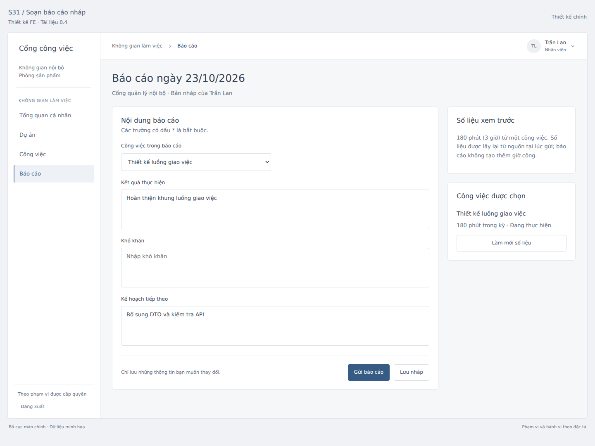

Persona trong ảnh chính: **Trần Lan · nhân viên/người nhận**. Áp dụng quyền từ phiên thực khi triển khai.

Trạng thái và cách xử lý: xem UI_STATES.txt theo mã Sxx; trạng thái nghiệp vụ/AI ở BUSINESS_STATES.txt và ANALYSIS_FLOW.txt.

- Feature: `reports`; dạng khung: `form`; route: `/reports/[reportId]/edit`.
- Phạm vi xem/thao tác: Tác giả báo cáo trong dự án còn quyền và đang ACTIVE.
- Use Case: UC-T10.
- Bảng dữ liệu: Công việc liên quan, Trạng thái hiện tại, Phút trong kỳ.

| Nhãn ô | Tên form | Control | Ghi chú |
|---|---|---|---|
| Công việc trong báo cáo | `selectedTaskIds` | select | Tùy điều kiện/loại thao tác; xem schema và whitelist |
| Kết quả thực hiện | `achievements` | textarea | Tùy điều kiện/loại thao tác; xem schema và whitelist |
| Khó khăn | `blockers` | textarea | Tùy điều kiện/loại thao tác; xem schema và whitelist |
| Kế hoạch tiếp theo | `nextPlan` | textarea | Tùy điều kiện/loại thao tác; xem schema và whitelist |
| Lý do nếu không có giờ công | `zeroTimeReason` | textarea | Tùy điều kiện/loại thao tác; xem schema và whitelist |

Action và đích: Làm mới số liệu → S31; Lưu nháp → S31; Gửi báo cáo → S32.

Điều kiện/diễn giải: Số liệu nháp có thể làm mới. Gửi báo cáo sẽ chốt số liệu tại lúc gửi; không tạo thêm giờ công.

Quy tắc triển khai: Lưu nháp cho phép nội dung chưa đầy đủ. Gửi bắt buộc achievements/nextPlan và zeroTimeReason nếu tổng tại lúc gửi bằng 0. selectedTaskIds chỉ là ID thuộc kỳ hợp lệ.

API: `getReportPreview`; `getReport`; `updateReportDraft`; `refreshReportDraft`; `submitReport`.

## S32 — Báo cáo đã gửi

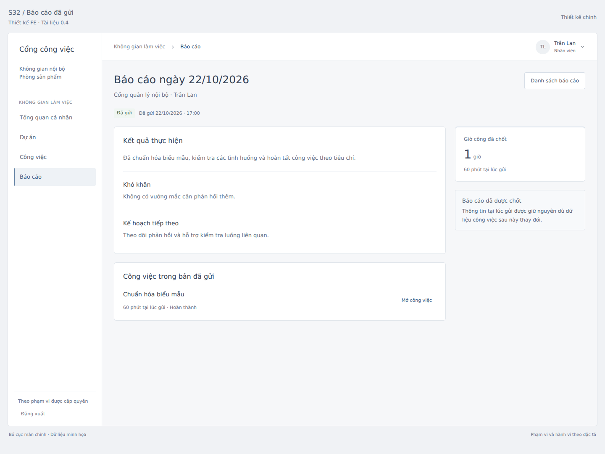

Persona trong ảnh chính: **Trần Lan · nhân viên/người nhận**. Áp dụng quyền từ phiên thực khi triển khai.

Trạng thái và cách xử lý: xem UI_STATES.txt theo mã Sxx; trạng thái nghiệp vụ/AI ở BUSINESS_STATES.txt và ANALYSIS_FLOW.txt.

- Feature: `reports`; dạng khung: `detail`; route: `/reports/[reportId]`.
- Phạm vi xem/thao tác: Tác giả hoặc người quản lý có quyền xem báo cáo đã gửi.
- Use Case: UC-T11.
- Bảng dữ liệu: Công việc tại lúc gửi, Trạng thái tại lúc gửi, Phút tại lúc gửi.
- Vùng nội dung: Kết quả thực hiện; Khó khăn và kế hoạch tiếp theo.

Action và đích: Mở công việc hiện tại → S18; Danh sách báo cáo → S29.

Điều kiện/diễn giải: Chốt số liệu: 23/10/2026, 17:00 · Kỳ ngày 23/10 · Giờ Việt Nam · Không sửa trực tiếp.

Quy tắc triển khai: Hiển thị snapshot tại lúc gửi; nút mở công việc dẫn sang dữ liệu hiện tại và phải giữ khác biệt hai mốc.

API: `getReport`.

## S33 — Bảng tổng quan

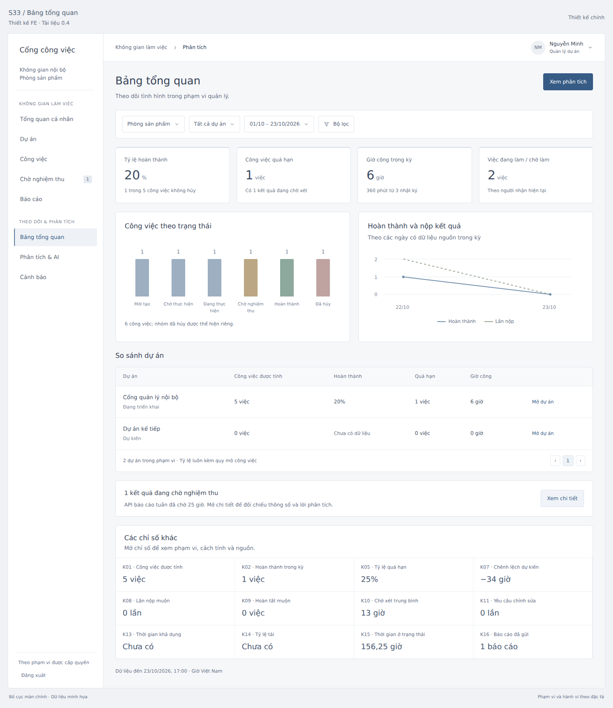

Persona trong ảnh chính: **Nguyễn Minh · quản lý có quyền dự án**. Áp dụng quyền từ phiên thực khi triển khai.

Trạng thái và cách xử lý: xem UI_STATES.txt theo mã Sxx; trạng thái nghiệp vụ/AI ở BUSINESS_STATES.txt và ANALYSIS_FLOW.txt.

- Feature: `analytics`; dạng khung: `dashboard`; route: `/dashboard`.
- Phạm vi xem/thao tác: Người có quyền ANALYTICS_VIEW trong phạm vi dự án/đơn vị được cấp.
- Use Case: UC-D01.
- Vùng nội dung: Tiến độ công việc; Phân bố trạng thái; Giờ công theo kỳ; Chỉ số theo kỳ và chất lượng dữ liệu; So sánh và xu hướng.

| Nhãn ô | Tên form | Control | Ghi chú |
|---|---|---|---|
| Đơn vị | `unitId` | select | Tùy điều kiện/loại thao tác; xem schema và whitelist |
| Dự án | `projectId` | select | Tùy điều kiện/loại thao tác; xem schema và whitelist |
| Người phụ trách dự án | `ownerId` | select | Tùy điều kiện/loại thao tác; xem schema và whitelist |
| Nhân viên | `assigneeId` | select | Tùy điều kiện/loại thao tác; xem schema và whitelist |
| Trạng thái công việc | `status` | select | Tùy điều kiện/loại thao tác; xem schema và whitelist |
| Ưu tiên | `priority` | select | Tùy điều kiện/loại thao tác; xem schema và whitelist |
| Từ ngày | `from` | date | Tùy điều kiện/loại thao tác; xem schema và whitelist |
| Đến ngày | `to` | date | Tùy điều kiện/loại thao tác; xem schema và whitelist |

Action và đích: Xem chi tiết phân tích → S43; Nguy cơ trễ hạn → S34; Khối lượng → S35; Điểm nghẽn → S36; Cảnh báo → S37; Tổng hợp phân tích → S39.

Điều kiện/diễn giải: Dữ liệu đến 23/10/2026, 17:00 · Giờ Việt Nam · Số liệu minh họa

Quy tắc triển khai: Phân biệt KPI hiện trạng và KPI theo kỳ. Bảo toàn bộ lọc khi drilldown. K13/K14 thiếu lịch là null; K16 không có lịch yêu cầu thì chưa tính tỷ lệ gửi đủ.

API: `getDashboard`.

Thay đổi LLM: nút Xem chi tiết dùng analysisRef/overviewRef của đúng hàng hoặc chỉ số để mở S43. GET màn này không tự gọi LLM. Không còn nút yêu cầu phân tích tự gửi type/project/kỳ cũ.

## S34 — Nguy cơ trễ hạn

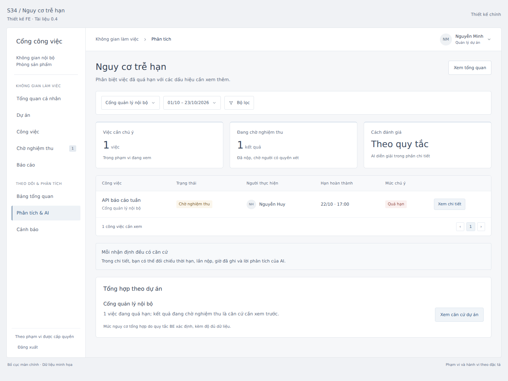

Persona trong ảnh chính: **Nguyễn Minh · quản lý có quyền dự án**. Áp dụng quyền từ phiên thực khi triển khai.

Trạng thái và cách xử lý: xem UI_STATES.txt theo mã Sxx; trạng thái nghiệp vụ/AI ở BUSINESS_STATES.txt và ANALYSIS_FLOW.txt.

- Feature: `analytics`; dạng khung: `analysis`; route: `/analytics/risks`.
- Phạm vi xem/thao tác: Người có quyền ANALYTICS_VIEW trong phạm vi dự án/đơn vị được cấp.
- Use Case: UC-D02.
- Bảng dữ liệu: Công việc, Nhóm nhận định, Căn cứ, Đủ dữ liệu.

Action và đích: Xem chi tiết phân tích → S43; Xem tổng quan → S33.

Điều kiện/diễn giải: Hiển thị phương pháp, phiên bản và thời điểm dữ liệu. Điểm quy tắc không được trình bày như xác suất dự báo.

API: `getDeadlineRisks`.

Thay đổi LLM: nút Xem chi tiết dùng analysisRef/overviewRef của đúng hàng hoặc chỉ số để mở S43. GET màn này không tự gọi LLM. Không còn nút yêu cầu phân tích tự gửi type/project/kỳ cũ.

## S35 — Khối lượng công việc

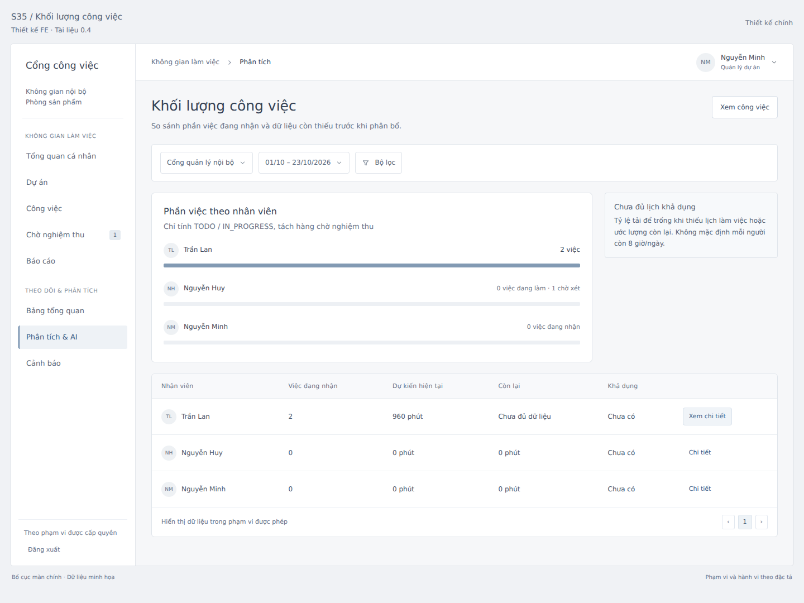

Persona trong ảnh chính: **Nguyễn Minh · quản lý có quyền dự án**. Áp dụng quyền từ phiên thực khi triển khai.

Trạng thái và cách xử lý: xem UI_STATES.txt theo mã Sxx; trạng thái nghiệp vụ/AI ở BUSINESS_STATES.txt và ANALYSIS_FLOW.txt.

- Feature: `analytics`; dạng khung: `analysis`; route: `/analytics/workload`.
- Phạm vi xem/thao tác: Người có quyền ANALYTICS_VIEW trong phạm vi dự án/đơn vị được cấp.
- Use Case: UC-D03.
- Bảng dữ liệu: Nhân viên, Việc đang thực hiện, Phút còn lại, Phút khả dụng, Tỷ lệ tải.

Action và đích: Xem chi tiết nhân viên → S43; Xem công việc → S15.

Điều kiện/diễn giải: Chỉ kết luận trong phạm vi được phép xem. Ước lượng ban đầu không tự được coi là thời gian còn lại.

Quy tắc triển khai: Phân biệt original/current estimate, remaining và capacity. Không mặc định một người có 8 giờ rảnh/ngày.

API: `getWorkload`.

Thay đổi LLM: nút Xem chi tiết dùng analysisRef/overviewRef của đúng hàng hoặc chỉ số để mở S43. GET màn này không tự gọi LLM. Không còn nút yêu cầu phân tích tự gửi type/project/kỳ cũ.

## S36 — Điểm nghẽn quy trình

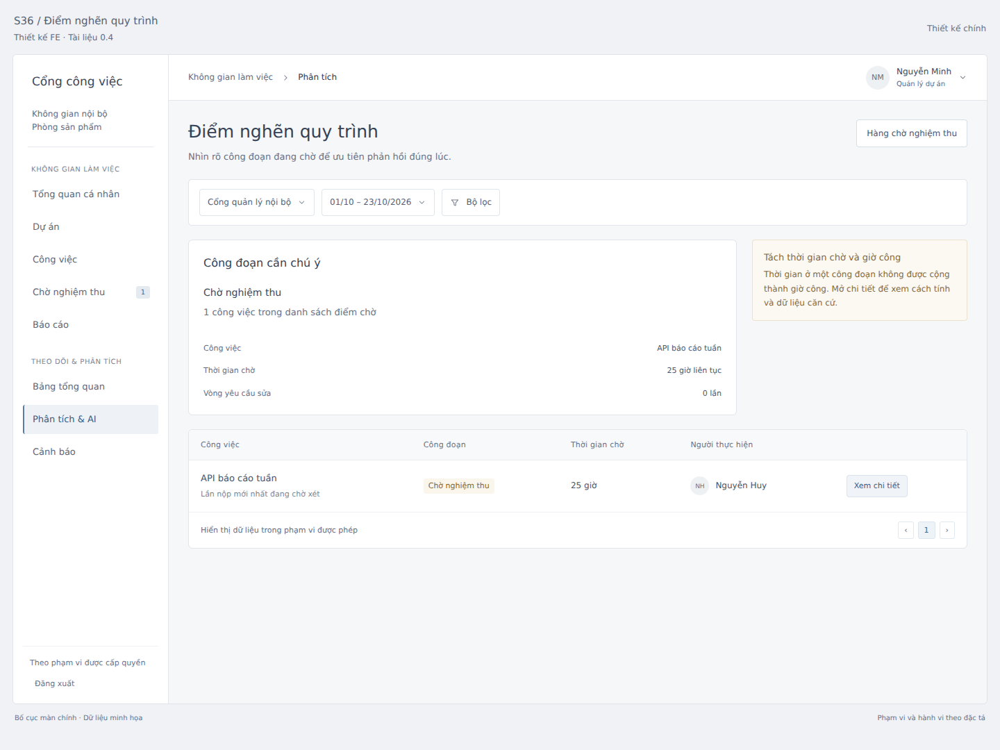

Persona trong ảnh chính: **Nguyễn Minh · quản lý có quyền dự án**. Áp dụng quyền từ phiên thực khi triển khai.

Trạng thái và cách xử lý: xem UI_STATES.txt theo mã Sxx; trạng thái nghiệp vụ/AI ở BUSINESS_STATES.txt và ANALYSIS_FLOW.txt.

- Feature: `analytics`; dạng khung: `analysis`; route: `/analytics/bottlenecks`.
- Phạm vi xem/thao tác: Người có quyền ANALYTICS_VIEW trong phạm vi dự án/đơn vị được cấp.
- Use Case: UC-D04.
- Bảng dữ liệu: Khâu xử lý, Công việc, Thời gian tồn đọng, Bằng chứng.

Action và đích: Xem chi tiết điểm chờ → S43; Hàng chờ nghiệm thu → S26.

Điều kiện/diễn giải: Tách thời gian chờ duyệt khỏi giờ công. Thiếu lịch làm việc thì ghi rõ cách tính theo giờ liên tục.

API: `getBottlenecks`.

Thay đổi LLM: nút Xem chi tiết dùng analysisRef/overviewRef của đúng hàng hoặc chỉ số để mở S43. GET màn này không tự gọi LLM. Không còn nút yêu cầu phân tích tự gửi type/project/kỳ cũ.

## S37 — Cảnh báo

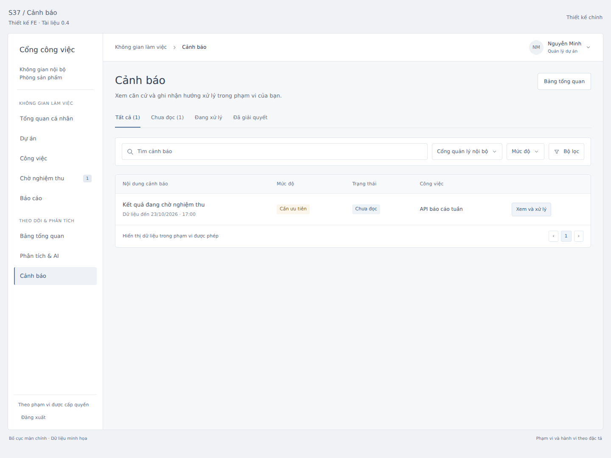

Persona trong ảnh chính: **Nguyễn Minh · quản lý có quyền dự án**. Áp dụng quyền từ phiên thực khi triển khai.

Trạng thái và cách xử lý: xem UI_STATES.txt theo mã Sxx; trạng thái nghiệp vụ/AI ở BUSINESS_STATES.txt và ANALYSIS_FLOW.txt.

- Feature: `alerts`; dạng khung: `list`; route: `/alerts`.
- Phạm vi xem/thao tác: Người có quyền ANALYTICS_VIEW trong phạm vi dự án/đơn vị được cấp.
- Use Case: UC-D05.
- Bảng dữ liệu: Vấn đề, Đối tượng, Mức độ, Tình trạng xử lý.

| Nhãn ô | Tên form | Control | Ghi chú |
|---|---|---|---|
| Trạng thái | `status` | select | Tùy điều kiện/loại thao tác; xem schema và whitelist |
| Mức độ | `severity` | select | Tùy điều kiện/loại thao tác; xem schema và whitelist |
| Dự án | `projectId` | select | Tùy điều kiện/loại thao tác; xem schema và whitelist |

Action và đích: Xem và xử lý → S38.

API: `listAlerts`.

## S38 — Chi tiết và xử lý cảnh báo

Màn/biểu mẫu phụ: đặc tả đầy đủ bằng văn bản, áp dụng DESIGN_SYSTEM và mẫu màn chính cùng feature.

Persona trong ảnh chính: **Nguyễn Minh · quản lý có quyền dự án**. Áp dụng quyền từ phiên thực khi triển khai.

Trạng thái và cách xử lý: xem UI_STATES.txt theo mã Sxx; trạng thái nghiệp vụ/AI ở BUSINESS_STATES.txt và ANALYSIS_FLOW.txt.

- Feature: `alerts`; dạng khung: `form`; route: `/alerts/[alertId]`.
- Phạm vi xem/thao tác: Xem cần ANALYTICS_VIEW; cập nhật cần ALERTS_MANAGE.
- Use Case: UC-D04, UC-D05.
- Vùng nội dung: Nguyên nhân và bằng chứng; Nguồn và lịch sử.

| Nhãn ô | Tên form | Control | Ghi chú |
|---|---|---|---|
| Trạng thái xử lý* | `status` | select | Có dấu * trong khung; kiểm tra điều kiện cụ thể trước submit |
| Hướng xử lý hoặc lý do* | `resolutionNote` | textarea | Có dấu * trong khung; kiểm tra điều kiện cụ thể trước submit |

Action và đích: Xem phân tích AI → S43; Mở công việc → S18; Lưu xử lý → S37.

Điều kiện/diễn giải: Cập nhật cảnh báo không tự đổi công việc. Khi cần điều chỉnh kế hoạch hoặc phân công, thực hiện qua chức năng tương ứng.

Quy tắc triển khai: Status READ có thể không cần note; IN_PROGRESS/RESOLVED/DISMISSED cần hướng xử lý hoặc lý do. Không đổi bằng chứng hoặc task status.

API: `getAlert`; `updateAlert`.

Thay đổi LLM: nút Xem chi tiết dùng analysisRef/overviewRef của đúng hàng hoặc chỉ số để mở S43. GET màn này không tự gọi LLM. Không còn nút yêu cầu phân tích tự gửi type/project/kỳ cũ.

## S39 — Tổng hợp phân tích và đề xuất

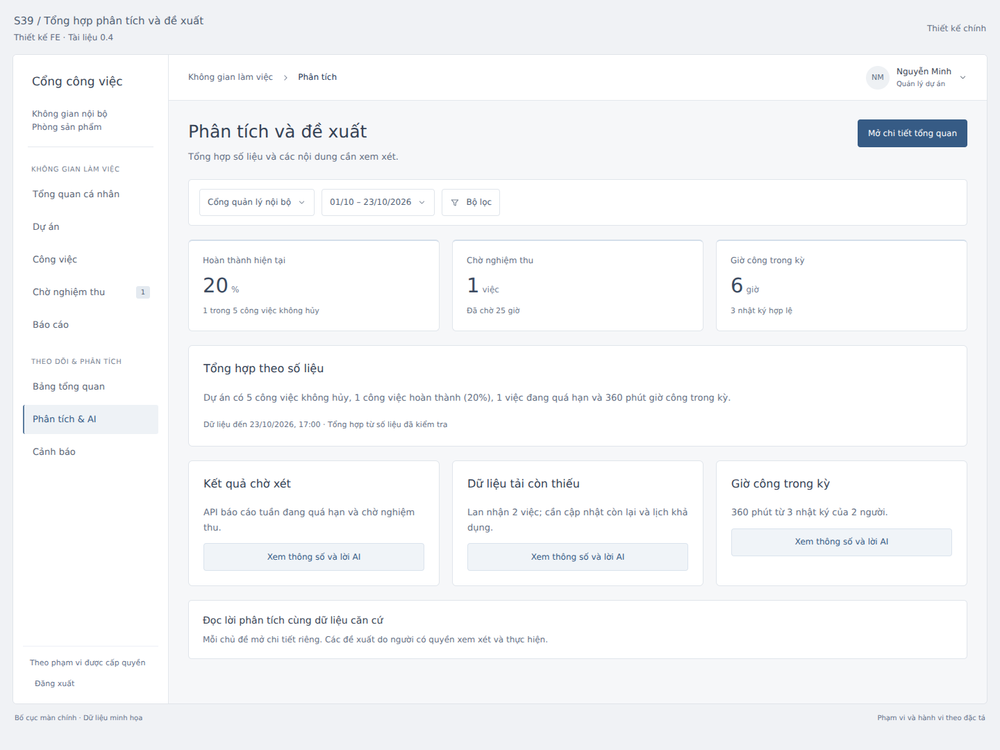

Persona trong ảnh chính: **Nguyễn Minh · quản lý có quyền dự án**. Áp dụng quyền từ phiên thực khi triển khai.

Trạng thái và cách xử lý: xem UI_STATES.txt theo mã Sxx; trạng thái nghiệp vụ/AI ở BUSINESS_STATES.txt và ANALYSIS_FLOW.txt.

- Feature: `analytics`; dạng khung: `summary`; route: `/analytics/summary`.
- Phạm vi xem/thao tác: Người có quyền ANALYTICS_VIEW trong phạm vi dự án/đơn vị được cấp.
- Use Case: UC-D06.
- Vùng nội dung: Tình hình có căn cứ; Dữ liệu cần bổ sung; Đề xuất để xem xét.

Action và đích: Mở phân tích tổng quan → S43; Xem chi tiết điểm cần chú ý → S43.

Điều kiện/diễn giải: Dữ liệu đến 23/10/2026, 17:00 · Diễn giải theo mẫu · Phạm vi: dự án đang chọn

API: `getAnalysisSummary`.

Thay đổi LLM: nút Xem chi tiết dùng analysisRef/overviewRef của đúng hàng hoặc chỉ số để mở S43. GET màn này không tự gọi LLM. Không còn nút yêu cầu phân tích tự gửi type/project/kỳ cũ.

## S40 — Tiến trình AI phân tích

Màn/biểu mẫu phụ: đặc tả đầy đủ bằng văn bản, áp dụng DESIGN_SYSTEM và mẫu màn chính cùng feature.

- Route /analytics/jobs/[jobId]; persona Nguyễn Minh; quyền ANALYTICS_VIEW cho snapshot của job.
- Loại phân tích, đối tượng, dự án, kỳ và mốc dữ liệu lấy từ job.analysisId/snapshot. Đây là thông tin readonly, không còn form analysisType/projectId/from/to để tự gửi dữ liệu.
- Hiển thị đã tiếp nhận/đang phân tích/hoàn tất hoặc thất bại, không dùng phần trăm giả. Có thể mở S43 đọc thông số ngay cả khi đang chạy.
- API getAnalysisJob; createAnalysisJob chỉ khi click Thử lại/Phân tích lại, body mới analysisId/generationMode/locale.
- GET không tự làm job chuyển trạng thái. Dừng poll khi terminal/rời màn/hết quyền; hết lượt theo dõi chỉ tạm dừng, không tự gán FAILED.
- Thành công: mở S43 đúng analysisId. Lỗi: typed message và nút retry theo retryable/retryAfterSeconds. Không làm mất metrics hoặc lastSuccess.
- Job thành công/thất bại/đang theo dõi: mô tả bằng ANALYSIS_FLOW.txt, không có PNG riêng.

## S41 — Tải tệp minh chứng

Màn/biểu mẫu phụ: đặc tả đầy đủ bằng văn bản, áp dụng DESIGN_SYSTEM và mẫu màn chính cùng feature.

Persona trong ảnh chính: **Trần Lan · nhân viên/người nhận**. Áp dụng quyền từ phiên thực khi triển khai.

Trạng thái và cách xử lý: xem UI_STATES.txt theo mã Sxx; trạng thái nghiệp vụ/AI ở BUSINESS_STATES.txt và ANALYSIS_FLOW.txt.

- Feature: `attachments`; dạng khung: `dialog`; route: `/tasks/[taskId]#attachment`.
- Phạm vi xem/thao tác: Người nhận hiện tại, dự án ACTIVE; thao tác thực hiện theo trạng thái.
- Use Case: UC-T07.
- Vùng nội dung: Tệp đang tải; Tệp hoàn tất.

| Nhãn ô | Tên form | Control | Ghi chú |
|---|---|---|---|
| Tệp minh chứng* | `file` | file | Có dấu * trong khung; kiểm tra điều kiện cụ thể trước submit |

Action và đích: Tải tệp → S41; Chọn tệp đã hoàn tất → S24.

Điều kiện/diễn giải: Chỉ tệp đúng loại, trong giới hạn cấu hình và tải lên hoàn tất mới được chọn vào lần nộp.

Quy tắc triển khai: File control không thuộc JSON DTO. Codex tạo upload form schema theo policy, multipart, rồi dùng ID READY trong S24. Phần trăm upload chỉ hiển thị khi uploader có nguồn tiến trình thực; nếu fetch wrapper không có tiến trình upload, dùng chỉ báo đang tải không xác định phần trăm.

API: `getUploadPolicy`; `uploadAttachment`; `getAttachment`.

## S42 — Không thể mở nội dung

Màn/biểu mẫu phụ: đặc tả đầy đủ bằng văn bản, áp dụng DESIGN_SYSTEM và mẫu màn chính cùng feature.

Persona trong ảnh chính: **Nguyễn Minh · quản lý có quyền dự án**. Áp dụng quyền từ phiên thực khi triển khai.

Trạng thái và cách xử lý: xem UI_STATES.txt theo mã Sxx; trạng thái nghiệp vụ/AI ở BUSINESS_STATES.txt và ANALYSIS_FLOW.txt.

- Feature: `system`; dạng khung: `system`; route: `/403 · /404 · error boundary`.
- Phạm vi xem/thao tác: Mọi phiên; không tiết lộ dữ liệu không được cấp quyền.
- Use Case: UC-A01, UC-T04.

Action và đích: Về không gian làm việc → S02; Thử tải lại → S42.

Điều kiện/diễn giải: Không tìm thấy nội dung hoặc bạn chưa được cấp quyền truy cập.

API: Màn hệ thống, không tạo request nghiệp vụ riêng..

## S43 — Chi tiết phân tích

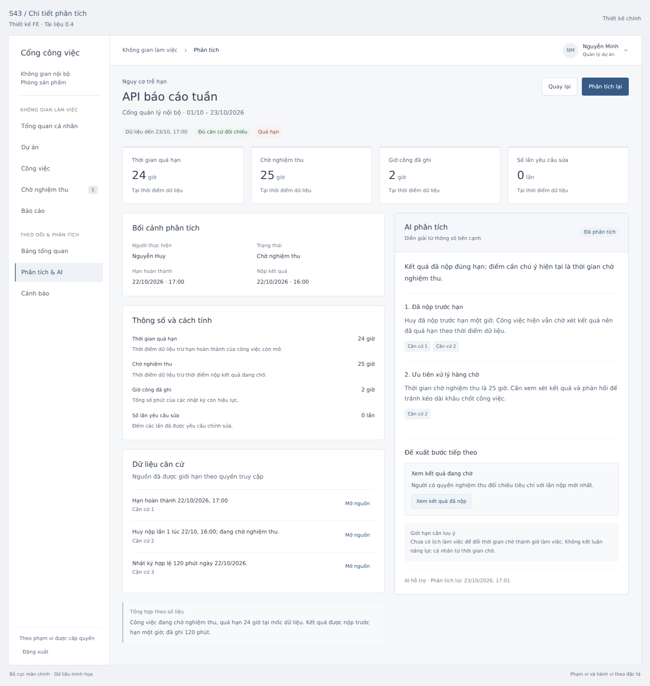

- Route: /analytics/details/[analysisId]. Feature analytics. Mở từ analysisRef của dashboard/KPI/nguy cơ/nhân viên/điểm nghẽn/cảnh báo/tổng hợp.
- Quyền: ANALYTICS_VIEW trong phạm vi nguồn; mỗi request kiểm tra quyền hiện tại. analysisId không phải bằng chứng đủ quyền.
- Persona ảnh: Nguyễn Minh. Nội dung mặc định RISK t-4: quá hạn 24 giờ, chờ xét 25 giờ, đã ghi 2 giờ, chưa có vòng yêu cầu sửa; Huy đã nộp đúng hạn.
- Các biến thể dùng cùng màn: RISK, WORKLOAD, BOTTLENECK, SUMMARY, METRIC. Không tạo một route hoặc feature mới cho mỗi loại.

### Bố cục và nội dung

Header có tên đối tượng, loại phân tích, dự án/kỳ, thời điểm dữ liệu, trạng thái chất lượng và Quay lại/Phân tích lại. Hàng metric đầu gồm tối đa bốn chỉ số quan trọng với đơn vị. Desktop chia hai cột: trái bối cảnh/công thức/biểu đồ/căn cứ; phải summary/findings/recommendations/limitations của AI. Chỉ số bổ sung vẫn hiện trong phần thông số. Mobile hiển thị metric rồi vùng AI, sau đó các căn cứ; không bắt người dùng cuộn qua toàn bộ bảng nguồn mới thấy lời AI.

Finding có nhãn rõ và citation nút Căn cứ trỏ đúng evidence; mở nguồn giữ quyền và dùng route mapper. Recommendation chỉ mở task/review/report phù hợp, không tự sửa dữ liệu. Ngày/giờ và công thức hiển thị bằng ngôn ngữ người dùng, không lộ tên biến kỹ thuật.

### Dữ liệu đọc và thao tác

GET detail trả snapshot/freshness/explanation/generation/systemSummary/feedback. Không form nhập thông số hay prompt. Nếu READY thì hiện kết quả; activeJobId thì poll job; NOT_REQUESTED và allowed thì một REUSE_OR_CREATE cho lượt mở chủ động. Phân tích lại dùng REGENERATE sau click; giữ kết quả tốt cùng snapshot khi lượt mới lỗi. Xem dữ liệu mới chuyển sang latestAnalysisId; nguồn cũ không bị ghi đè.

API: getAnalysisDetail, createAnalysisJob, getAnalysisJob; createAnalysisFeedback cho BOTTLENECK khi canSubmit. Không gọi provider LLM trực tiếp từ FE. Query key: viewerId + analysisId; job key: viewerId + jobId. Mọi DTO/citation/state khớp snapshot trước khi vào cache.

### Biến thể nội dung và trạng thái

RISK, WORKLOAD, BOTTLENECK, SUMMARY và METRIC dùng cùng mẫu S43. Nội dung, enum, thiếu dữ liệu, AI lỗi/chạy, outdated và expired được mô tả đầy đủ ở ANALYSIS_FLOW.txt và MOCK_MODELS.txt. Không xuất ảnh biến thể.

## Đối chiếu 27 Use Case

| UC | API | Màn |
|---|---|---|
| UC-A01 | `login`, `refreshSession`, `getSession` | S01, S02 |
| UC-A02 | `logout` | S01, S02 |
| UC-A03 | `listUsers`, `createUser` | S03, S04 |
| UC-A04 | `listUsers`, `getUser`, `updateUser`, `lockUser`, `unlockUser`, `resetUserPassword` | S03, S05 |
| UC-A05 | `listUnits`, `getUnit`, `createUnit`, `updateUnit`, `deactivateUnit`, `listTeams`, `getTeam`, `createTeam`, `updateTeam`, `replaceTeamMembers`, `deactivateTeam` | S06, S07 |
| UC-D01 | `listAnalyticsFilterOptions`, `getDashboard`, `getAnalysisDetail` | S33, S43 |
| UC-D02 | `listAnalyticsFilterOptions`, `getDeadlineRisks`, `createAnalysisJob`, `getAnalysisJob`, `getAnalysisDetail` | S34, S40, S43 |
| UC-D03 | `listAnalyticsFilterOptions`, `updateRemainingEstimate`, `getWorkload`, `createAnalysisJob`, `getAnalysisJob`, `getAnalysisDetail` | S18, S35, S40, S43 |
| UC-D04 | `listAnalyticsFilterOptions`, `createAnalysisFeedback`, `getBottlenecks`, `createAnalysisJob`, `getAnalysisJob`, `getAnalysisDetail` | S36, S40, S43 |
| UC-D05 | `listAlerts`, `getAlert`, `updateAlert`, `getAnalysisDetail` | S37, S38, S43 |
| UC-D06 | `listAnalyticsFilterOptions`, `getAnalysisSummary`, `createAnalysisJob`, `getAnalysisJob`, `getAnalysisDetail` | S39, S40, S43 |
| UC-P01 | `createProject` | S09 |
| UC-P02 | `updateProject`, `activateProject`, `getProjectClosureChecks`, `completeProject`, `cancelProject`, `listProjectHistory` | S10, S11, S14 |
| UC-P03 | `listProjects`, `getProject` | S02, S08, S10 |
| UC-P04 | `listProjectMembers`, `addProjectMember`, `endProjectMembership` | S12 |
| UC-P05 | `updateProjectMemberRole` | S13 |
| UC-T01 | `createTask` | S17 |
| UC-T02 | `assignTask` | S20 |
| UC-T03 | `updateTask`, `cancelTask` | S19, S21 |
| UC-T04 | `listTasks`, `getTask` | S02, S15, S16, S18, S26 |
| UC-T05 | `startTask`, `pauseTask` | S21 |
| UC-T06 | `listTimeLogs`, `createTimeLog`, `updateTimeLog`, `voidTimeLog` | S22, S23 |
| UC-T07 | `listSubmissions`, `createSubmission`, `getUploadPolicy`, `uploadAttachment`, `getAttachment`, `downloadAttachment` | S24, S25, S27, S41 |
| UC-T08 | `getSubmission`, `approveSubmission`, `listReviewQueue`, `getAttachment`, `downloadAttachment` | S24, S26, S27, S41 |
| UC-T09 | `getSubmission`, `requestSubmissionRevision`, `listReviewQueue` | S26, S27 |
| UC-T10 | `getReportPreview`, `createReportDraft`, `updateReportDraft`, `refreshReportDraft`, `submitReport` | S30, S31 |
| UC-T11 | `listTaskHistory`, `listSubmissions`, `listReports`, `getReport` | S25, S28, S29, S31, S32 |

## Bổ sung chức năng sau đối chiếu nguồn 0.4

- S33: chọn đơn vị/dự án/kỳ, có chế độ tất cả dự án trong quyền, so sánh quy mô/tỷ lệ/giờ/quá hạn. projectComparisons có projectName/actualMinutes; không tự suy tên/giờ. Nhóm/owner/assignee/status/priority là filter nâng cao theo DTO; reset page và filter con khi đổi phạm vi.
- S34: ngoài bảng task, có tổng hợp nguy cơ dự án từ projects[] có ruleIds/evidence/quality/ref PROJECT; không lấy tỷ lệ cảnh báo làm xác suất.
- S35: chọn nhóm nhân sự và kỳ theo teamId/unitId/projectId; chỉ trả tải trong scope. Không dùng listUsers/listUnits/listTeams quản trị để tra nhãn; dùng listAnalyticsFilterOptions.
- S39: summaryText luôn hiện dưới nhãn “Tổng hợp theo số liệu”; LLM lỗi không làm mất nội dung theo mẫu đã kiểm tra.
- S43: systemSummary từ cùng snapshot luôn đọc được; lời AI là vùng riêng. BOTTLENECK có xác nhận/bác bỏ nhận định khi feedback.canSubmit. Khi click, mở form verdict và comment bắt buộc 1–2000 ký tự sau trim. Chỉ gửi verdict/comment; giữ input khi lỗi, idempotency khi thử lại. Sau thành công hiện feedback.latest, không đổi task, cảnh báo hay nội dung nhận định gốc.
- Các màn rời trang/đăng xuất có dirty form phải nhắc lưu hoặc xác nhận bỏ, không âm thầm mất nháp.

S33/S39 chế độ nhiều dự án: SUMMARY dùng subject UNIT và snapshot scope đơn vị, không dùng ref/lời của một dự án thay cho toàn bộ đơn vị. Khi không chọn được scope hợp lệ, yêu cầu chọn thay vì hiển thị số ngoài quyền.
